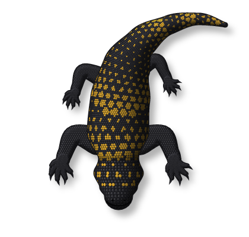
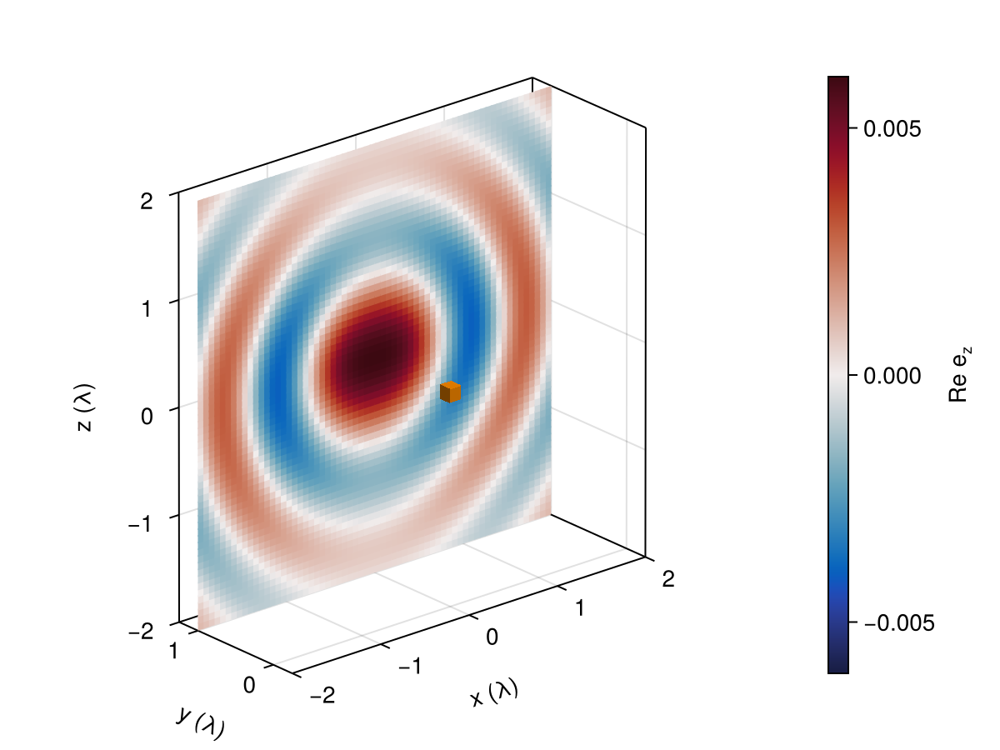
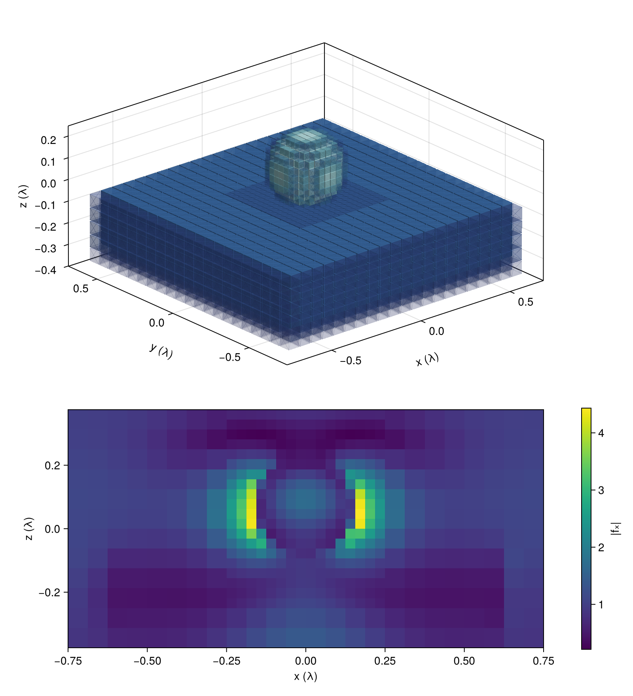

# GilaElectromagnetics.jl

*Green in linear algebra*

[](https://github.com/moleskySean/GilaElectromagnetics.jl/actions)
[](http://codecov.io/github/moleskySean/GilaElectromagnetics.jl?branch=main)
[](https://moleskySean.github.io/GilaElectromagnetics.jl/stable)
[](https://moleskySean.github.io/GilaElectromagnetics.jl/dev)

GilaElectromagnetics (Gila, for short) computes the action of the discrete
vacuum Green function of Maxwell's equations in three dimensions, and it does so
*fast*. Stored naïvely, the Green function is a dense matrix, which is
*terribly* infeasible to compute with: at 32 cells per wavelength, a moderate
$64\lambda^3$ domain would need 288 TiB of storage. Luckily, free space is
translation invariant, so the Green function only depends on the separation
between two cells. Gila exploits this to store it in $O(N)$ memory and apply it
in $O(N\log N)$ time with FFTs. With that in hand, we can also solve the
scattering problem (in the JVIE formulation) for any linear, non-magnetic
material, with open or Bloch-periodic boundaries along each axis.

The [documentation](https://moleskysean.github.io/GilaElectromagnetics.jl/stable)
explains what Gila computes and how (see the Theory section), and has a set of
tutorials to get you going.

## Installation

You can install Gila with Julia's package manager:

```julia-repl
julia> using Pkg
julia> Pkg.add("GilaElectromagnetics")
```

or, from the REPL, type `]` to enter [Pkg
mode](https://docs.julialang.org/en/v1/stdlib/Pkg/) and run

```
pkg> add GilaElectromagnetics
```

Note that Gila needs Julia 1.11 or newer.

## Precision

Operators store `Complex{T}` data, where `T` is either `Float32` (the default,
i.e., `GlaOpr(vol, sus)`) or `Float64` (`GlaOpr{Float64}(vol, sus)`). The Green
function itself is always computed in `Float64` and then rounded once into
whatever precision you asked for. When you want `Float64` accuracy out of a
solve but would rather pay for `Float32` matvecs, use our mixed-precision
refinement solver: `GlaOpr{Float64}(vol, sus; slv=MixPrcRfn(Float32))`.

## GPUs

Every constructor that builds an operator or a field takes a `dev` keyword (a
`KernelAbstractions.Backend`, `CPU()` by default). To run on a GPU, load the GPU
package and pass its backend:

```julia
using GilaElectromagnetics, CUDA # or Metal, or OpenCL
G = GlaOpr{Float32}(vol, sus; dev=CUDABackend())
```

CUDA, Metal and OpenCL all use VkFFT for their FFTs. You can move an operator or
a field from one backend to another with `adapt(dev, x)`. Metal and OpenCL have
no `Float64`, so building a `Float64` operator there throws.

## Showcase

Here is a single cell of current radiating, and the field it makes on a sheet
one wavelength away ([script](examples/readme/radiating_cell.jl)):

<picture>
  <source media="(prefers-color-scheme: dark)" srcset="examples/readme/radiating_cell-dark.png">
  
</picture>

Below, a silicon sphere sits on a glass pad and is illuminated from above by a
plane wave. The mesh is refined around the sphere (see the top panel), and the
bottom panel shows the total field in the middle slice
([script](examples/readme/sphere_on_pad.jl)):

<picture>
  <source media="(prefers-color-scheme: dark)" srcset="examples/readme/sphere_on_pad-dark.png">
  
</picture>

The documentation has more examples, along with the computational details we skipped here.
