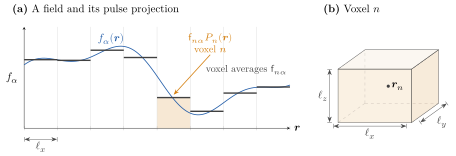

# [3 Discretization](@id sec-3)

So far, we've been talking about Maxwell's equations in continuous space. When
we solve these equations numerically, we must discretize space to have a finite
representation of the fields and currents. There is real subtlety in doing this
(discussed briefly in [section 2.2](@ref sec-2.2)) and so we dedicate this section to
discussing how we discretize our vectors and operators in Gila. The main goal of
this section is to establish notation that is clean enough that we will be able
to write the continuous scattering equation ``\ab(\bbone -
\bm{X}\bm{G}_{\circ})\vb*{p}_\text{s} = \vb*{p}_\text{d}`` as easily as the
discrete one ``\ab(\vb*{\mathsf{I}} -
\vb*{\mathsf{X}}\vb*{\mathsf{G}}_{\circ})\vb*{\mathsf{p}}_\text{s} =
\vb*{\mathsf{p}}_\text{d}``.

## [3.1 Fields in Hilbert Spaces](@id sec-3.1)

When we write ``\vb*{f}_\text{t}``, we are talking about a field
``\vb*{f}_\text{t}\ab(\vb*{r})`` at a point ``\vb*{r}`` in space. It will be
incredibly convenient to talk about the entire field distribution, that is,
every point in space, as a single vector. To do this, we will define
``\mathcal{H} = \ab[L^2\ab(\Omega)]^{6}`` as the Hilbert space of square
integrable vector fields over the complex vector space ``\mathbb{C}^{6}`` in the
domain ``\Omega``. Any element of ``\mathcal{H}`` is a vector denoted by
``\ket|f>``, and the value of this vector at a point ``\vb*{r}`` is denoted by
``\braket<\vb*{r}|{f}> = \vb*{f}\ab(\vb*{r})``. Note that since
``\vb*{f}\ab(\vb*{r})`` is a vector in ``\mathbb{C}^{6}``, we also have to label
its components (polarization and electric/magnetic). To do this, we add a label
``\alpha`` and write ``\braket<{\vb*{r}, \alpha}|{f}> = f_\alpha\ab(\vb*{r})`` as the
``\alpha``-th component of the field at point ``\vb*{r}``. The inner product of two vectors ``\ket|f>, \ket|g> \in \mathcal{H}`` is defined as:

```math
\braket<{f}|{g}> = \int_{\Omega} \vb*{f}^\dagger\ab(\vb*{r}) \vb*{g}\ab(\vb*{r}) \dd{V} = \sum_{\alpha=1}^{6} \int_{\Omega} f_\alpha^*\ab(\vb*{r}) g_\alpha\ab(\vb*{r}) \dd{V}
```

The completeness relation for the position-polarization basis is then:

```math
\begin{align*}
\bbone &= \sum_{\alpha=1}^{6} \int_{\Omega} \ketbra|{\vb*{r}, \alpha}><{\vb*{r}, \alpha}| \dd{V}
\end{align*}
```

An operator, ``\bm{G}_{\circ}``, is a linear map on ``\mathcal{H}``. Its kernel is its matrix element
between position labels which we denote as:

```math
\begin{align*}
\ab[\bm{\mathcal{G}}_{\circ}\ab(\vb*{r}, \vb*{r}^\prime)]_{\mu\nu} &= \braket<{\vb*{r}, \mu}|{\bm{G}_{\circ}}|{\vb*{r}^\prime, \nu}>
\end{align*}
```

The Green function kernel ``\bm{\mathcal{G}}_{\circ}\ab(\vb*{r},
\vb*{r}^\prime)`` is a ``6\times6`` complex matrix that connects the ``\nu``-th
component of the current at point ``\vb*{r}^\prime`` to the ``\mu``-th component
of the field at point ``\vb*{r}``. The action of the Green function operator
everywhere in space is then written as:

```math
\begin{align*}
    \ket|f> &= \bm{G}_{\circ}\ket|p> \\
    \implies f_\alpha\ab(\vb*{r}) &= \sum_{\beta=1}^{6} \int_{\Omega}
\braket<{\vb*{r}, \alpha}|{\bm{G}_{\circ}}|{\vb*{r}^\prime, \beta}> \braket<{\vb*{r}^\prime, \beta}|{p}> \dd{V^\prime} \\
    &= \sum_{\beta=1}^{6} \int_{\Omega} \ab[\bm{\mathcal{G}}_{\circ}\ab(\vb*{r}, \vb*{r}^\prime)]_{\alpha\beta} p_\beta\ab(\vb*{r}^\prime) \dd{V^\prime}
\end{align*}
```

The defining property of the Green function as the right inverse of the Maxwell
operator, ``\bm{M}_{\circ}\bm{G}_{\circ} = \bbone``, is written as
``\bm{\mathcal{M}}_{\circ}\bm{\mathcal{G}}_{\circ}\ab(\vb*{r}, \vb*{r}^\prime) = \bbone
\delta\ab(\vb*{r - r^\prime})`` in kernel form.

## [3.2 Discretizing ``\mathcal{H}``](@id sec-3.2)

We obviously cannot represent the entire Hilbert space ``\mathcal{H}`` on a
computer. One way of discretizing the Hilbert space is to choose a finite set of
basis function ``\{\ket|\phi_i>\}_{i=1}^{N}`` and project the Hilbert space onto the
span of these basis functions. There are many basis functions we could choose
from, all with the advantages and disadvantages. In Gila, since we discretize
space on a uniform cuboid grid, we choose basis functions that are localized to
each grid point. The simplest choice therein is that of a piecewise constant
basis function. Adding more terms (say, adding linear, quadratic, or higher
order polynomials) would cost significantly more memory without adding
as much accuracy, comparatively.

Let ``\Omega`` be discretized into ``N = N_xN_yN_z`` voxels of volume ``\Delta V
= \ell_x \ell_y \ell_z`` (with ``\ell_i`` in wavelength-scaled units,
see [convention 1.1](maxwell.md#conv-1.1)) with centers ``\vb*{r}_n``. Then, for each voxel ``n``
and polarization ``\alpha``, define the basis function ``\ket|\phi_{n\alpha}>``
as (see [fig. 3.1](#fig-3.1)):

```math
\begin{align*}
    \braket<{\vb*{r}, \beta}|{\phi_{n\alpha}}> =
    \delta_{\alpha\beta}P_n\ab(\vb*{r}),&\qquad P_n\ab(\vb*{r}) =
    \begin{cases}
        1 & \vb*{r} \in \text{voxel } n \\
        0 & \text{otherwise}
    \end{cases}
\end{align*}
```

```@raw html
<a id="fig-3.1"></a>
```


Figure 3.1: (a) Projecting a field component ``f_\alpha(\vb*{r})`` (blue) onto pulse
functions. Each coefficient ``\mathsf{f}_{n\alpha}`` is the average of the
field over voxel ``n`` (black steps). The shaded region is one basis
function ``P_n(\vb*{r})`` scaled by its coefficient. (b) Voxel ``n``: an
axis-aligned box with edge lengths ``\ell_x, \ell_y, \ell_z`` (in units of
wavelengths) and center ``\vb*{r}_n``.

These functions are discontinuous across voxel boundaries which is allowed since
the JVIE unknowns are in ``L^2`` (see [section 2.2](@ref sec-2.2)). We define the inner product of two basis functions as:

```math
\begin{align*}
    \braket<{\phi_{m\alpha}}|{\phi_{n\beta}}> &= \delta_{mn}\delta_{\alpha\beta}\Delta V
\end{align*}
```

Notice that this means that the volume of a voxel is carried in the linear
functional (the dual space) and not in the basis function itself.

### [3.2.1 Discretizing Fields and Currents](@id sec-3.2.1)

A field ``\ket|f> \in \mathcal{H}`` can be projected onto the span of the basis
functions as:

```math
\begin{align*}
    \ket|f> &= \sum_{n=1}^{N} \sum_{\alpha=1}^{6} \frac{1}{\Delta V} \ket|\phi_{n\alpha}> \braket<{\phi_{n\alpha}}|{f}> \\
            &= \sum_{n=1}^{N} \sum_{\alpha=1}^{6} \mathsf{f}_{n\alpha} \ket|\phi_{n\alpha}>
\end{align*}
```

Because our basis functions are pulse functions, the coefficients
``\mathsf{f}_{n\alpha}`` of the discretized field are simply the average of the
field over the voxel:

```@raw html
<a id="eq-3.1"></a>
```
```math
\begin{align*}
\mathsf{f}_{n\alpha} &= \frac{1}{\Delta V_n} \braket<{\phi_{n\alpha}}|{f}> =
\frac{1}{\Delta V_n} \int_{\text{voxel } n} f_\alpha\ab(\vb*{r}) \dd{V} \approx
f_\alpha\ab(\vb*{r}_n)\tag{3.1}
\end{align*}
```

Notice that this means that the coefficients ``\mathsf{f}_{n\alpha}`` carry an
explicit ``1 / \Delta V``, but the projections ``\braket<{\phi_{n\alpha}}|{f}>``
carry a volume factor from the integral so that ``\mathsf{f}_{n\alpha}`` has
dimensions of field.

### [3.2.2 Discretizing Operators](@id sec-3.2.2)

We will define discrete operators with the same normalization as the fields and
currents. That is, the discretized vacuum Green function
``\bm{\mathsf{G}}_{\circ}`` and the discretized material tensor
``\bm{\mathsf{X}}`` have elements:

```@raw html
<a id="eq-3.2"></a>
```
```math
\begin{align*}
\ab[\bm{\mathsf{G}}_{\circ}]_{m\alpha, n\beta} &= \frac{1}{\Delta V_m} \braket<{\phi_{m\alpha}}|{\bm{G}_{\circ}}|{\phi_{n\beta}}> = \frac{1}{\Delta V_m} \int_{\text{voxel } m} \dd{V} \int_{\text{voxel } n} \dd{V^\prime} \ab[\bm{\mathcal{G}}_{\circ}\ab(\vb*{r}, \vb*{r}^\prime)]_{\alpha\beta}\tag{3.2} \\
\ab[\bm{\mathsf{X}}]_{m\alpha, n\beta} &= \frac{1}{\Delta V_m} \braket<{\phi_{m\alpha}}|{\bm{X}}|{\phi_{n\beta}}> = \frac{1}{\Delta V_m} \int_{\text{voxel } m} \dd{V} \int_{\text{voxel } n} \dd{V^\prime} \ab[\bm{\mathcal{X}}\ab(\vb*{r}, \vb*{r}^\prime)]_{\alpha\beta}
\end{align*}
```

Note, again, that usually[^7] we assume ``\bm{\mathcal{X}}``
to be local so that it is just a constant matrix in each voxel.

[^7]: By default in Gila, ``\bm{\mathcal{X}}`` is discretized as a local operator [`SusOpr`](@ref).

## [3.3 Galerkin Projection](@id sec-3.3)

In our finite basis, we can never hope to solve ``\ab(\bbone -
\bm{X}\bm{G}_{\circ})\ket|p_{\text{s}}> = \ket|p_{\text{d}}>`` exactly.
Instead, we will try to make the residual, ``\ket|\rho> = \ab(\bbone -
\bm{X}\bm{G}_{\circ})\ket|p_{\text{s}}> - \ket|p_{\text{d}}>`` zero in the
span of our basis functions. This means that, up to what the finite basis can
resolve, we will have solved the equation exactly. Of course, there is still a
residual in the continuum space (specifically, in the orthogonal complement of
the span of our basis functions), but we assume that our basis functions resolve
the fields and currents well enough that this residual does not contribute
significant physics.

Making this residual zero in the span of our basis functions is called the
Galerkin method. Specifically, what we require is:

```math
\begin{align*}
0 &= \braket<{\phi_{m\alpha}}|{\rho}>\ \forall\ m, \alpha \\
&= \braket<{\phi_{m\alpha}}|{\ab(\bbone - \bm{X}\bm{G}_{\circ})}|{p_{\text{s}}}> - \braket<{\phi_{m\alpha}}|{p_{\text{d}}}> \\
&= \bra<{\phi_{m\alpha}}|\ab(\bbone - \bm{X}\bm{G}_{\circ})\ab[\sum_{n=1}^{N} \sum_{\beta=1}^{6} \ab(\mathsf{p}_\text{s})_{n\beta} \ket|\phi_{n\beta}>] - \bra<\phi_{m\alpha}|\ab[\sum_{n=1}^{N} \sum_{\beta=1}^{6} \ab(\mathsf{p}_{\text{d}})_{n\beta} \ket|\phi_{n\beta}>] \\
&= \sum_{n=1}^{N} \sum_{\beta=1}^{6}\ab[\ab(\mathsf{p}_{\text{s}})_{n\beta} \braket<{\phi_{m\alpha}}|{\ab(\bbone - \bm{X}\bm{G}_{\circ})}|{\phi_{n\beta}}> - \ab(\mathsf{p}_{\text{d}})_{n\beta}\braket<{\phi_{m\alpha}}|{\phi_{n\beta}}>]
\end{align*}
```

Since all of our inner products are normalized with a ``1 / \Delta V`` factor,
we can factor it out to get the discrete scattering equation:

```math
\begin{align*}
    0 &= \sum_{n=1}^{N} \sum_{\beta=1}^{6} \ab[\ab(\mathsf{p}_{\text{s}})_{n\beta} \ab[\ab(\vb*{\mathsf{I}} - \vb*{\mathsf{X}}\vb*{\mathsf{G}}_{\circ})]_{m\alpha, n\beta} - \ab(\mathsf{p}_{\text{d}})_{n\beta}\delta_{mn}\delta_{\alpha\beta}]
\end{align*}
```

Written in matrix form, this is:

```@raw html
<a id="eq-3.3"></a>
```
```math
\begin{align*}
\ab(\mathsf{I} - \mathsf{X}\mathsf{G}_{\circ})\vb*{\mathsf{p}}_\text{s} &= \vb*{\mathsf{p}}_\text{d} \tag{3.3}
\end{align*}
```

It may seem like we've done nothing, but the point is that our discretized
version of the scattering looks exactly the same as the continuous version. To
do this, we had to be careful about our normalization. This normalization can
cost us some confusion for the units of the various quantities. To remedy this,
you can find a summary of the units and dimensions of all the quantities we have
discussed so far in [table 1](#tab-1).

```@raw html
<a id="tab-1"></a>
```
Table 1: Units of the continuous quantities in this document (all in SI
derived units). Fields and sources are in the frequency domain, so they
carry an extra factor of seconds compared to their time-domain
counterpart.

| **Quantity** | **Description** | **Units** | **Space** |
|:--|:--|:--|:--|
| ``\omega`` | Angular frequency | rad s⁻¹ | ``\in \mathbb{C}`` |
| ``k_\circ`` | Free space wavenumber | rad m⁻¹ | ``\in \mathbb{C}`` |
| ``Z_\circ`` | Free space impedance | Ω | ``\in \mathbb{C}`` |
| ``\varepsilon_\circ`` | Permittivity of free space | F m⁻¹ | ``\in \mathbb{C}`` |
| ``\mu_\circ`` | Permeability of free space | H m⁻¹ | ``\in \mathbb{C}`` |
| ``\lambda`` | Free space wavelength | m | ``\in \mathbb{R}`` |
| ``\vb*{p}\ab(\omega, \vb*{r})`` | Generalized current | A s m⁻¹ | ``\in \mathbb{C}^{6}`` |
| ``\bm{M}_\circ\ab(\omega)`` | Maxwell operator | Ω⁻¹ | operator on ``\mathcal{H}`` |
| ``\bm{G}_\circ\ab(\omega)`` | Vacuum Green operator | Ω | operator on ``\mathcal{H}`` |
| ``g_\circ\ab(R)`` | Scalar Green function | m⁻¹ | ``\in \mathbb{C}`` |
| ``\bm{W}\ab(\omega)`` | Scattering operator | Dimensionless | operator on ``\mathcal{H}`` |
| ``\bm{T}\ab(\omega)`` | Transition operator, ``\bm{W}\bm{X}`` | Ω⁻¹ | operator on ``\mathcal{H}`` |
| ``\vb*{f}\ab(\omega, \vb*{r})`` | Generalized field | V s m⁻¹ | ``\in \mathbb{C}^{6}`` |
| ``\bm{X}\ab(\omega, \vb*{r})`` | Material tensor | Ω⁻¹ | ``\in \mathbb{C}^{6\times6}`` |
| ``\vb*{j}_e\ab(\omega, \vb*{r})`` | Electric (volume)[^8] current density | A s m⁻² | ``\in \mathbb{C}^{3}`` |
| ``\vb*{j}_m\ab(\omega, \vb*{r})`` | Magnetic (volume) current density | A m⁻¹ | ``\in \mathbb{C}^{3}`` |
| ``\bm{\varepsilon}\ab(\omega, \vb*{r})`` | Permittivity tensor | F m⁻¹ | ``\in \mathbb{C}^{3\times3}`` |
| ``\vb*{e}\ab(\omega, \vb*{r})`` | Electric field | V s m⁻¹ | ``\in \mathbb{C}^{3}`` |
| ``\vb*{h}\ab(\omega, \vb*{r})`` | Auxiliary magnetic field | A s m⁻¹ | ``\in \mathbb{C}^{3}`` |
| ``\vb*{P}\ab(\omega, \vb*{r})`` | Electric dipole density (polarization) | A s² m⁻² | ``\in \mathbb{C}^{3}`` |
| ``\vb*{M}\ab(\omega, \vb*{r})`` | Magnetic dipole density (magnetization) | A s m⁻¹ | ``\in \mathbb{C}^{3}`` |
| ``\bm{\chi}_e\ab(\omega, \vb*{r})`` | Electric susceptibility tensor | Dimensionless | ``\in \mathbb{C}^{3\times3}`` |
| ``\bm{\chi}_m\ab(\omega, \vb*{r})`` | Magnetic susceptibility tensor | Dimensionless | ``\in \mathbb{C}^{3\times3}`` |

[^8]: "Volume" here refers to the fact that the current lives in a volume, not that it has units of current per volume

```@raw html
<a id="tab-2"></a>
```
Table 2: Units of the discrete (*sans serif*) quantities. Lengths
are in units of wavelengths, and ``N = n_xn_yn_z``.
``{}^\dagger``Gila stores or returns this divided by ``Z_\circ``, which makes
it dimensionless for ``\bm{\mathsf{G}}_\circ`` and has units of
``\vb*{\mathsf{p}}`` for ``\vb*{\mathsf{f}}``
(see [convention 4.3](matrix_elements.md#conv-4.3)). ``{}^\ddagger``Gila stores ``\chi``, which is
dimensionless.

| **Quantity** | **Description** | **Units** | **Space** |
|:--|:--|:--|:--|
| ``\vb*{\mathsf{p}}_\text{s}, \vb*{\mathsf{p}}_\text{d}`` | Current coefficients | A s m⁻¹ | ``\in \mathbb{C}^{3N}`` |
| ``\vb*{\mathsf{f}}`` | Field coefficients | V s m⁻¹``{}^\dagger`` | ``\in \mathbb{C}^{3N}`` |
| ``\bm{\mathsf{G}}_\circ`` | Discrete Green operator | Ω``{}^\dagger`` | ``\in \mathbb{C}^{3N\times 3N}`` |
| ``\bm{\mathsf{X}}`` | Discrete material tensor | Ω⁻¹``{}^\ddagger`` | ``\in \mathbb{C}^{3N\times 3N}`` |
| ``\bm{\mathsf{I}}`` | Identity | Dimensionless | ``\in \mathbb{C}^{6N\times6N}`` |
| ``\bm{\mathsf{W}}`` | ``(\bm{\mathsf{I}} - \bm{\mathsf{X}}\bm{\mathsf{G}}_\circ)^{-1}`` | Dimensionless | ``\in \mathbb{C}^{3N\times 3N}`` |
| ``\ab[\bm{\mathsf{T}}]_{m\alpha,n\beta}`` | Surface-integral term of ``\bm{\mathsf{G}}_\circ`` | ``\lambda^3`` | ``\in \mathbb{C}`` |
| ``c_F^{F'}`` | Face-pair sign | Dimensionless | ``\in \{-1, 0, 1\}`` |
| ``\mathsf{c}_{\alpha\beta}\ab(\vb*{\mathsf{r}})`` | First column of ``\bm{\mathsf{G}}_\circ`` | Ω``{}^\dagger`` | ``\in \mathbb{C}`` |
| ``\tilde{\bm{\mathsf{G}}}_\circ`` | Fourier symbol of ``\bm{\mathsf{G}}_\circ`` | Ω``{}^\dagger`` | ``\in \mathbb{C}^{8N}`` per ``\alpha\beta`` |
| ``\bm{\mathsf{F}}_\gamma`` | DFT along ``\gamma`` | Dimensionless | ``\in \mathbb{C}^{2n_\gamma\times2n_\gamma}`` |
| ``\bm{\mathsf{E}}_\gamma`` | Zero-padding embedding | Dimensionless | ``\in \mathbb{R}^{2n_\gamma\times n_\gamma}`` |
| ``\bm{\mathsf{P}}_\gamma`` | Projection, ``\bm{\mathsf{E}}_\gamma^\dagger`` | Dimensionless | ``\in \mathbb{R}^{n_\gamma\times2n_\gamma}`` |
| ``\phi_\gamma`` | Half-phase twiddle (diagonal) | Dimensionless | ``\in \mathbb{C}^{n_\gamma\times n_\gamma}`` |
| ``\vb*{\mathsf{r}}`` | Position | ``\lambda`` | ``\in \mathbb{R}^3`` |
| ``\vb*{\mathsf{s}}`` | Scaled separation | ``\lambda`` | ``\in \mathbb{R}^3`` |
| ``\vb*{\mathsf{L}}`` | Periodicity vector | ``\lambda`` | ``\in \mathbb{R}^3`` |
| ``\vb*{\mathsf{k}}`` | Bloch wavevector | rad``/\lambda`` | ``\in \mathbb{R}^3`` |
| ``\vb*{\mathsf{r}}`` | Residual (iterative solvers) | A s m⁻¹ | ``\in \mathbb{C}^{3N}`` |
| ``\bm{\mathsf{B}}`` | Born preconditioner | Dimensionless | ``\in \mathbb{C}^{3N\times3N}`` |
| ``\bm{\mathsf{A}}, \vb*{\mathsf{b}}, \vb*{\mathsf{x}}, \vb*{\mathsf{y}}`` | Generic linear system | — | — |
| ``\bm{\mathsf{M}}_l, \bm{\mathsf{M}}_r`` | Left, right preconditioners | As ``\bm{\mathsf{A}}`` | ``\in \mathbb{C}^{3N\times 3N}`` |

```@raw html
<a id="tab-3"></a>
```
Table 3: Units of the kernels and spaces (calligraphic symbols).
A kernel carries an extra m⁻³ relative to its operator, because the operator integrates it over a volume element ``\dd{V'}``.

| **Quantity** | **Description** | **Units** | **Space** |
|:--|:--|:--|:--|
| ``\bm{\mathcal{G}}_\circ\ab(\vb*{r}, \vb*{r}')`` | Kernel of (the electric block of) ``\bm{G}_\circ`` | Ω m⁻³ | ``\in \mathbb{C}^{3\times 3}`` |
| ``\bm{\mathcal{X}}\ab(\vb*{r}, \vb*{r}')`` | Kernel of (the electric block of) ``\bm{X}`` | Ω⁻¹ m⁻³ | ``\in \mathbb{C}^{3\times 3}`` |
| ``\bm{\mathcal{M}}_\circ\ab(\vb*{r}, \vb*{r}')`` | Kernel of (the electric block of) ``\bm{M}_\circ`` (a distribution) | Ω⁻¹ m⁻³ | ``\in \mathbb{C}^{3\times 3}`` |
| ``\mathcal{H}`` | Hilbert space ``\ab[L^2(\Omega)]^6`` | — | — |
| ``\mathcal{K}_k\ab(\bm{\mathsf{A}}, \vb*{\mathsf{b}})`` | Krylov subspace | --- | ``\subseteq \mathbb{C}^{3N}`` |

## [3.4 Julia Arrays](@id sec-3.4)

A vector ``\mathsf{p}_\text{d}`` is an array of coefficients as described
in [eq. (3.1)](#eq-3.1). Because of the pulse basis function the entry
``\ab(n, \alpha)`` holds the average of the ``\alpha`` component of the current in
voxel ``n``. This means that you never have to worry about the factor of
``\Delta V`` when you are just dealing with solving the scattering
equation [eq. (3.3)](#eq-3.3).

The factor of ``\Delta V`` only comes into play when you are computing inner
products. This is common enough (e.g., when computing the power absorbed in a
volume), that we have a custom field type that handles this for you.

```@raw html
<a id="conv-3.1"></a>
```
!!! convention "Gila convention 3.1: Field Type for Consistent Units"
    Having to remember to multiply by ``\Delta V`` when computing inner products is
    annoying and error-prone. To avoid this, Gila has a custom field type,
    [`GlaFld`](@ref), that automatically multiplies by the correct volume factor when
    computing inner products. It is highly recommended to use this type when using
    Gila for anything, even solving [eq. (3.3)](#eq-3.3). This type is a
    subtype of `AbstractArray` and so it behaves like a normal array in all
    respects. Since you can have different meshing (i.e., differently sized voxels)
    in different parts of the domain, it is very easy to get the normalization wrong
    if you do not use [`GlaFld`](@ref).

    The only reason we do not *require* the use of [`GlaFld`](@ref) is that
    certain algorithms in other packages (e.g., the randomized singular value
    decomposition) accept regular arrays. As long as these algorithms do not compute
    inner products, it is safe to use regular arrays.

If you do not want to use [`GlaFld`](@ref), note that the rule is that any inner
product must be multiplied by ``\Delta V``:

```math
\begin{align*}
    \braket<f|g> &= \Delta V \mathsf{f}^\dagger \mathsf{g} = \Delta V\cdot
\mathtt{dot\ab(f, g)} \\
    \braket<f|{\bm{G}_{\circ}}|g> &= \Delta V \mathsf{f}^\dagger
\mathsf{G}_{\circ} \mathsf{g} = \Delta V\cdot \mathtt{dot\ab(f, G_\circ * g)}
\end{align*}
```
