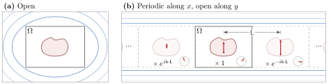
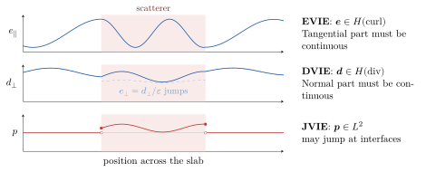

# [2 JVIE Formulation](@id sec-2)

The type of equation that we choose to solve is extremely important. There are
so many different ways to write Maxwell's equations, and choosing which
formulation is best for a given problem can be quite complex. In this section we
briefly justify the choice for formulation used in Gila, the JVIE formulation.

## [2.1 Boundary Conditions](@id sec-2.1)

You may recall that the solution to any differential equation is only unique
once either initial or boundary conditions are specified. In the case of
Maxwell's equations, many possible initial and boundary conditions exist. In
Gila, we only consider two types of boundary conditions: open (radiation) and
periodic (see [fig. 2.1](#fig-2.1)). Open boundary conditions are such that any radiation that leaves the
domain will not come back in (and is assumed to be absorbed at infinity).
Periodic boundary conditions are such that the currents are periodic on the
boundary. The periodic boundary conditions in Gila are specifically Bloch-phase
quasi-periodic obeying ``\vb*{\mathsf{p}}(\vb*{\mathsf{r}} + \vb*{\mathsf{L}}) =
e^{-i\vb*{\mathsf{k}}\cdot\vb*{\mathsf{L}}}\vb*{\mathsf{p}}(\vb*{\mathsf{r}})``
where ``\vb*{\mathsf{L}}`` is the periodicity vector and ``\vb*{\mathsf{k}}`` is
the Bloch wavevector.

```@raw html
<a id="fig-2.1"></a>
```


Figure 2.1: Examples of boundary conditions in Gila. (a) Open: radiation leaving ``\Omega``
travels off to infinity and never returns. (b) Periodic along ``x`` and
open along ``y``: ``\Omega`` is repeated with period
``\vb*{\mathsf{L}}``, with each copy carrying a phase
``e^{-i\vb*{\mathsf{k}}\cdot\vb*{\mathsf{L}}}`` relative to its
neighbour, while radiation still escapes along ``y``. The red arrows are
the same dipole in every cell (at the same instant). The inset circle show its complex amplitude,
which rotates by ``-\vb*{\mathsf{k}}\cdot\vb*{\mathsf{L}}`` from one cell to the next, so the instantaneous dipole
shrinks and flips across the copies.

Note that we could even mix and match these boundary conditions, for example, we
could have a waveguide with periodic boundary conditions in the longitudinal
direction and open boundary conditions in the transverse direction. The choice
of boundary conditions can have a significant impact on the solution to
Maxwell's equations, and it is important to choose the appropriate boundary
conditions for the problem at hand.

Open boundary conditions are nice for finite size systems, which is very natural
for inverse design problems—where Gila takes its roots. We will see later on
(see [section 5](@ref sec-5)) that open boundary conditions (as well as periodic
boundary conditions) enjoy an extremely useful property (translational
invariance) which is exactly what we exploit to make Gila *fast*.

## [2.2 Integral Equations in Electromagnetics](@id sec-2.2)

What makes Gila *accurate* is a combination of the choice of equation that
we solve together with how we solve it. Maxwell's equations are typically
written in differential form, as in [eq. (1.2)](maxwell.md#eq-1.2), but they can also
be written in integral form. On a finite (numerical) grid, differential forms
must discretize the operator ``\vb*{\nabla}\times `` over all space. To simulate finite
systems, these differential formulations must truncate the domain through
absorbing layers (e.g., perfectly matched layers). Discretized differential
operators amplify the noise associated with the discretization of space
(mathematically, the problem is that these operators are unbounded). What makes
them nice is that they are local operators, meaning that they only depend on the
fields at a point and its neighbours. This gives rise to a sparse matrix
representation of ``\bm{M}_{\circ}`` which is extremely nice to numerical linear
algebra.

The operator ``\bm{G}_{\circ}``, being the inverse of ``\bm{M}_{\circ}``, is an
integral operator. Integral operators solve free-space propagation
analytically—the kernel of ``\bm{G}_{\circ}`` is a closed-form function
(see [section 4](@ref sec-4))—so free-space propagation is exact. Since
these are integral operators, they smooth out the noise associated with
discretization of space (mathematically, these operators are bounded). The
problem is that ``\bm{G}_{\circ}`` is terribly non-local, meaning that it
depends on the fields at all points in space. This gives rise to a matrix
representation of ``\bm{G}_{\circ}`` which is dense, and thus (naïvely) very
expensive to store and apply.

We will see that Gila exploits the translational invariance of
``\bm{G}_{\circ}`` to do away with these problems, leaving us with the best of
both worlds: an integral operator that is fast to apply and does not amplify
discretization noise.

There are a few different ways of writing Maxwell's equations as an integral
equation. For volume integral equations (i.e., the unknowns are defined over a
volume), there are EVIE (where the unknowns are the electric field), DVIE (where
the unknowns are the electric displacement field), and JVIE (where the unknowns
are the polarization current density). The nature of Maxwell's equations is such
that ``\vb*{e}`` must have square integrable curl (i.e., we must have tangential
continuity of ``\vb*{e}`` across material boundaries) and ``\vb*{d}`` must have square integrable divergence (i.e., we must have normal continuity of
``\vb*{d}`` across material boundaries). The three different formulations have
different properties (see [fig. 2.2](#fig-2.2)):

1. EVIE: The unknown electric field, ``\vb*{e} \in H\ab(\text{curl})``, must enforce tangential continuity across material boundaries. This is a significant computational burden in inverse design problems where we expect many material boundaries.
2. DVIE: The unknown electric displacement field, ``\vb*{d} \in H\ab(\text{div})``, must enforce normal continuity across material boundaries. This is also a significant computational burden in inverse design problems.
3. JVIE: The unknown polarization current density, ``\vb*{p} \in L^2``, does not require any continuity across material boundaries, only square integrability. This is ideal for inverse design problems.

```@raw html
<a id="fig-2.2"></a>
```


Figure 2.2: The unknown of each volume integral equation along a line crossing a
scatterer (shaded). EVIE: the
tangential electric field is continuous across the interfaces. DVIE: the
normal displacement is continuous, while the normal electric field
(dashed) is not. JVIE: the polarization current
is zero outside the scatterer and jumps at the boundary.

There is an additional argument for the JVIE formulation, which is that it is
the only formulation that is well-conditioned for high-contrast scatterers
(i.e., media with many interfaces, such as the ones we find in inverse
design) [polimeridis_stable_2014](@cite).

Note that none of this is new. We've only written the JVIE formulation so far
(in [eq. (1.4)](maxwell.md#eq-1.4)), but the formulations are also well-known, and it is
important to state why we choose the JVIE formulation over them.
