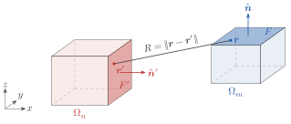
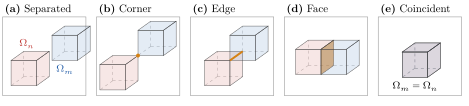

# [4 Evaluating the Green Function's Matrix Elements](@id sec-4)

We have yet to discuss what ``\bm{G}_{\circ}`` actually is. In this section, we will briefly derive an expression for the Green function in free space, and then give a high level overview of how to evaluate its matrix elements. A slightly more in depth (but not quite complete) explanation of how Gila evaluates the Green function matrix elements is given in [section 4.3](@ref sec-4.3).

## [4.1 Derivation of the Electric Dyadic Vacuum Green Function](@id sec-4.1)

Let's work with the electric part of the vacuum Green function, though a similar derivation can be done for the magnetic part and the off-diagonals. Recall Maxwell's equations in matrix form, [eq. (1.2)](maxwell.md#eq-1.2):

```math
\begin{align*}
    \begin{bmatrix}
        ik_{\circ}^{-1}\vb*{j}_e\ab(\vb*{r}) \\
        Z_{\circ}\varepsilon_{\circ}ik_{\circ}^{-1}\vb*{j}_m\ab(\vb*{r})
    \end{bmatrix} & =
    - Z_{\circ}^{-1} \begin{bmatrix}
        \bbone &  -ik_{\circ}^{-1}\vb*{\nabla}\times \\
        ik_{\circ}^{-1}\vb*{\nabla}\times & \bbone
    \end{bmatrix}\begin{bmatrix}
        \vb*{e}\ab(\vb*{r}) \\
        Z_{\circ}\vb*{h}\ab(\vb*{r})
    \end{bmatrix}
\end{align*}
```

For the electric part, we set ``\vb*{j}_m\ab(\vb*{r}) = 0`` to get two equations (note that we will now drop the explicit dependence on ``\vb*{r}`` for brevity):

```@raw html
<a id="eq-4.1"></a>
```

```@raw html
<a id="eq-4.2"></a>
```

```math
\begin{align*}
    \frac{i}{k_{\circ}}\vb*{j}_e &= - Z_{\circ}^{-1}\vb*{e} + \frac{i}{k_{\circ}}\vb*{\nabla}\times \vb*{h}\tag{4.1} \\
    - Z_{\circ}^{-1}\vb*{\nabla}\times \vb*{e} &= \frac{k_{\circ}}{i} \vb*{h}\tag{4.2}
\end{align*}
```

Taking the curl of the first equation and substituting in the second equation, we find (after a quick simplification):

```@raw html
<a id="eq-4.3"></a>
```

```math
\begin{align*}
    \vb*{\nabla}\times \vb*{j}_e &= \vb*{\nabla}\times\vb*{\nabla}\times \vb*{h}
- k_{\circ}^2\vb*{h} = \ab(\vb*{\nabla}\times \vb*{\nabla}\times -k_{\circ}^2)\vb*{h}\tag{4.3}
\end{align*}
```

Taking the divergence of [eq. (4.2)](#eq-4.2), we have that:

```math
\begin{align*}
    \vb*{\nabla}\cdot \vb*{h} &= -\frac{i}{k_{\circ}}Z_{\circ}^{-1}
\vb*{\nabla}\cdot \ab(\vb*{\nabla}\times \vb*{e}) = \vb*{0}
\end{align*}
```

as the divergence of a curl is always zero. Now we use the vector identity ``\vb*{\nabla}\times \vb*{\nabla}\times \vb*{\psi} = \vb*{\nabla}\ab(\vb*{\nabla}\cdot \vb*{\psi}) - \nabla^2 \vb*{\psi}`` on ``\vb*{h}`` to get ``\vb*{\nabla}\times \vb*{\nabla}\times \vb*{h} = -\nabla^2\vb*{h}``. Substituting this into [eq. (4.3)](#eq-4.3), we have:

```@raw html
<a id="eq-4.4"></a>
```

```math
\begin{align*}
    \vb*{\nabla}\times \vb*{j}_e &= -\ab(\nabla^2 + k_{\circ}^2)\vb*{h}\tag{4.4}
\end{align*}
```

Notice that the above equation is satisfied independently for each component of ``\vb*{h}``, i.e., [eq. (4.4)](#eq-4.4) is three of the same scalar equation. We can use this to solve the scalar version of the equation and the vector equation will automatically be satisfied.

Suppose we had a function ``g_{\circ}\ab(\vb*{s})`` that satisfied ``-\ab(\nabla^2 + k_{\circ}^2)g_{\circ}\ab(\vb*{s}) = \delta\ab(\vb*{s})``. Then we have:

```math
\begin{align*}
    \int_{\mathbb{R}^3} \dd[3]{\vb*{r}^\prime} g_{\circ}\ab(\vb*{r} - \vb*{r}^\prime) \ab[\vb*{\nabla}^\prime\times \vb*{j}_e]\ab(\vb*{r}^\prime) &= \int_{\mathbb{R}^3} \dd[3]{\vb*{r}^\prime} \underbrace{g_{\circ}\ab(\vb*{r} - \vb*{r}^\prime) \ab(-\ab(\nabla^{\prime2} + k_{\circ}^2))}_{\delta\ab(\vb*{r} - \vb*{r}^\prime)}\vb*{h}\ab(\vb*{r}^\prime) \\
    &= \vb*{h}\ab(\vb*{r})
\end{align*}
```

This type of function, ``g_{\circ}``, is called a (scalar) Green function, and we can think of it simultaneously as the inverse of a differential operator (the inverse of the operator in [eq. (4.4)](#eq-4.4), in this case), and as the solution of the differential equation under a point source (or a unit impulse). It is a very powerful tool in solving differential equations. One of the tricky bits, is finding an actual expression for ``g_{\circ}``. Note that ``e^{\pm ik_{\circ} R} / \ab(4\pi R)`` (with ``R = \abs{\vb*{r} - \vb*{r}^\prime}``) is a solution to the equation ``-\ab(\nabla^2 + k_{\circ}^2)g_{\circ}\ab(\vb*{s}) = \delta\ab(\vb*{s})``:

For ``R > 0``:

```math
\begin{align*}
    \nabla^2\frac{e^{\pm ik_{\circ} R}}{4\pi R} &= \frac{1}{4\pi}\nabla^2\ab(\frac{e^{\pm ik_{\circ} R}}{R}) \\
    &= \frac{1}{4\pi R^2} \pdv{}{R}\ab(R^2 \pdv{}{R}\ab(\frac{e^{\pm ik_{\circ} R}}{R})) \\
    &= -k_{\circ}^2 \frac{e^{\pm ik_{\circ} R}}{4\pi R}
\end{align*}
```

For ``R = 0``:

```math
\begin{align*}
    \lim_{R \to 0}\nabla^2\frac{e^{\pm ik_{\circ} R}}{4\pi R} &= \lim_{R \to 0}\frac{1}{4\pi}\nabla^2\bigg(\frac{1}{R} \pm ik_{\circ}R \\
    &\qquad \mp \frac{1}{2}k_{\circ}^2 R^3 \pm \order{R^5}\bigg) \\
    &= \frac{1}{4\pi}\lim_{R \to 0}\big(-4\pi\delta\ab(\vb*{r} - \vb*{r}^\prime) \\
    &\qquad + 0 \mp \frac{1}{2}k_{\circ}^2 \frac{2}{R} \pm \ldots\big) \\
    &= -\delta\ab(\vb*{r} - \vb*{r}^\prime) - k_{\circ}^2 \frac{e^{\pm ik_{\circ} R}}{4\pi R}
\end{align*}
```

We choose to take the ``+`` branch of ``g_{\circ}``, as physically this corresponds to allowing waves to exit to domain to infinity[^9] (taking the ``-`` branch would mean letting waves from infinity enter our domain), corresponding to open (radiating) boundary conditions.

```@raw html
<a id="conv-4.1"></a>
```

!!! convention "Gila convention 4.1: Complex Frequencies in Gila"
    Note that in Gila we allow for a complex frequency factor, ``\zeta \in \mathbb{C}``, defined by ``\omega = \zeta c k_{\circ}``. All the integrals discussed in [section 4.3](@ref sec-4.3) numerically converge for any ``\zeta`` with ``\Im(\zeta) \ge 0``. You can set ``\zeta`` by passing a complex number to the `frqPhz` keyword of the operator constructors (e.g., [`GlaOprVac`](@ref)).

Notice that since ``\vb*{g}_{\circ}`` is scalar, it depends only on the norm of its argument, which is symmetric under exchange of ``\vb*{r}`` and ``\vb*{r}^\prime``, that is: ``g_{\circ}\ab(\norm{\vb*{r} - \vb*{r}^\prime}) = g_{\circ}\ab(\norm{\vb*{r}^\prime - \vb*{r}}) \coloneq g_{\circ}\ab(R)``. Thus, the following holds (using ``\vb*{r}^{\dprime} = \vb*{r} - \vb*{r}^\prime`` and ``r_i`` as a component of ``\vb*{r}``):

```math
\begin{align*}
\pdv{}{r_i}\int_{\mathbb{R}^3} \dd[3]{\vb*{r}^\prime} g_{\circ}\ab(\norm{\vb*{r} - \vb*{r}^\prime}) f\ab(\vb*{r}^\prime) &= \int_{\mathbb{R}^3} \dd[3]{\vb*{r}^\prime} \pdv{}{r_i}\ab[g_{\circ}\ab(\norm{\vb*{r} - \vb*{r}^\prime}) f\ab(\vb*{r}^\prime)] \\
&= \int_{\mathbb{R}^3} \dd[3]{\vb*{r}^{\dprime}} \pdv{}{r_i}\ab[g_{\circ}\ab(\norm{\vb*{r}^{\dprime}}) f\ab(\vb*{r} - \vb*{r}^{\dprime})] \\
&= \int_{\mathbb{R}^3} \dd[3]{\vb*{r}^{\dprime}} g_{\circ}\ab(\norm{\vb*{r}^{\dprime}}) \pdv{}{r_i}f\ab(\vb*{r} - \vb*{r}^{\dprime}) \\
&= \int_{\mathbb{R}^3} \dd[3]{\vb*{r}^\prime} g_{\circ}\ab(\norm{\vb*{r} - \vb*{r}^\prime}) \pdv{}{r^\prime_i}f\ab(\vb*{r}^\prime)
\end{align*}
```

Then, starting from our Green function solution for ``\vb*{h}`` above and using the derivation above to commute the curl operator with the scalar Green function, we get:

```math
\begin{align*}
\vb*{h}\ab(\vb*{r}) &= \vb*{\nabla}\times \int_{\mathbb{R}^3} \dd[3]{\vb*{r}^\prime}g_{\circ}\ab(\norm{\vb*{r} - \vb*{r}^\prime}) \vb*{j}_e\ab(\vb*{r}^\prime)
\end{align*}
```

Since we are using pulse basis functions over a finite domain (because ultimately we can only store finitely many voxels in our computer's memory), we can restrict the domain of integration to a finite volume ``\Omega\subset \mathbb{R}^3`` over which the currents have compact support. Now, we substitute this into [eq. (4.1)](#eq-4.1) to get:

```math
\begin{align*}
    \frac{i}{k_{\circ}}\vb*{j}_e\ab(\vb*{r}) &= - Z_{\circ}^{-1}\vb*{e}\ab(\vb*{r}) + \frac{i}{k_{\circ}}\vb*{\nabla}\times \vb*{\nabla}\times \int_{\Omega} \dd[3]{\vb*{r}^\prime}g_{\circ}\ab(\norm{\vb*{r} - \vb*{r}^\prime}) \vb*{j}_e\ab(\vb*{r}^\prime)
\end{align*}
```

Recalling our definition of ``\vb*{p}`` and ``\vb*{f}`` in [eq. (1.2)](maxwell.md#eq-1.2) this is:

```math
\begin{align*}
\vb*{p}_e\ab(\vb*{r}) &=-Z_{\circ}^{-1}\vb*{f}_e\ab(\vb*{r}) + \vb*{\nabla}\times \vb*{\nabla}\times \int_{\Omega} \dd[3]{\vb*{r}^\prime}g_{\circ}\ab(\norm{\vb*{r} - \vb*{r}^\prime}) \vb*{p}_e\ab(\vb*{r}^\prime) \\
\implies \vb*{f}_e\ab(\vb*{r}) &= Z_{\circ}\ab(-\bbone + \vb*{\nabla}\times \vb*{\nabla}\times \int_{\Omega} \dd[3]{\vb*{r}^\prime}g_{\circ}\ab(\norm{\vb*{r} - \vb*{r}^\prime}) \bm{\bbone})\vb*{p}_e\ab(\vb*{r})
\end{align*}
```

Just as we defined ``g_{\circ}`` as an operator that inverted the (scalar) Helmholtz equation, [eq. (4.4)](#eq-4.4), we can define a dyadic Green function operator, ``\bm{G}_{\circ}``, that inverts Maxwell's equations above. Specifically, we define ``\bm{G}^{ee}_{\circ}`` as the (electric part[^10] of the) linear operator satisfying:

```math
\begin{align*}
\bbone &= Z_{\circ}\ab(-\bbone + \vb*{\nabla}\times \vb*{\nabla}\times \int_{\Omega} \dd[3]{\vb*{r}^\prime}g_{\circ}\ab(\norm{\vb*{r} - \vb*{r}^\prime})\bbone)\bm{G}^{ee}_{\circ}
\end{align*}
```

so that we may write ``\vb*{f}_e\ab(\vb*{r}) = \bm{G}^{ee}_{\circ}\vb*{p}_e\ab(\vb*{r})``. In Gila, we only worry about the electric part, so we will drop the ``ee`` superscript and just write:

```@raw html
<a id="eq-4.5"></a>
```

```math
\begin{align*}
\bm{G}_{\circ} &= Z_{\circ}\ab(-\bbone + \vb*{\nabla}\times \vb*{\nabla}\times g_{\circ}\bbone)\tag{4.5}
\end{align*}
```

where integration over ``\Omega`` is implied in the ``\vb*{\nabla}\times \vb*{\nabla}\times g_{\circ}`` term. In kernel form, this is:

```@raw html
<a id="eq-4.6"></a>
```

```math
\begin{align*}
\bm{\mathcal{G}}_{\circ}\ab(\vb*{r}, \vb*{r}^\prime) &= Z_{\circ}\ab(-\bbone\delta\ab(\vb*{r} - \vb*{r}^\prime) + \vb*{\nabla}\times \vb*{\nabla}\times g_{\circ}\ab(\norm{\vb*{r} - \vb*{r}^\prime})\bbone)\tag{4.6}
\end{align*}
```

## [4.2 Kernel Matrix Elements](@id sec-4.2)

Substituting [eq. (4.6)](#eq-4.6) into our definition of the discretized Green function matrix elements, [eq. (3.2)](discretization.md#eq-3.2), we have:

```math
\begin{align*}
\ab[\mathsf{G}_{\circ}]_{m\alpha, n\beta} &= \frac{1}{\Delta V_m}\int_{\Omega_m} \dd[3]{\vb*{r}} \int_{\Omega_n} \dd[3]{\vb*{r}^\prime} \braket<{\phi_{m\alpha}}|{\bm{\mathcal{G}}_{\circ}\ab(\vb*{r}, \vb*{r}^\prime)}|{\phi_{n\beta}}> \\
&= \frac{Z_{\circ}}{\Delta V_m}\int_{\Omega_m} \dd[3]{\vb*{r}} \int_{\Omega_n} \dd[3]{\vb*{r}^\prime} \ab(-\braket<{\phi_{m\alpha}}|{\bbone\delta\ab(\vb*{r} - \vb*{r}^\prime)}|{\phi_{n\beta}}> + \braket<{\phi_{m\alpha}}|{\vb*{\nabla}\times \vb*{\nabla}\times g_{\circ}\ab(\norm{\vb*{r} - \vb*{r}^\prime})\bbone}|{\phi_{n\beta}}>)
\end{align*}
```

where ``\Omega_m`` and ``\Omega_n`` are the volumes defining voxels ``m`` and ``n``.

```@raw html
<a id="conv-4.2"></a>
```

!!! convention "Gila convention 4.2: Axis-Aligned Voxels"
    In Gila, we require that the voxels are axis-aligned, i.e., that the edges of the voxels are parallel to the axes of the coordinate system. You can create axis-aligned volumes with the [`GlaVol`](@ref) type. We do not require that the voxels are cubes (i.e., the edges may have arbitrary lengths). We also do not require that the voxels in ``\Omega_m`` and ``\Omega_n`` are the same size, though they may be (unless you are working with the ``\bm{\mathsf{W}}`` operator, [`SctOpr`](@ref), or any other operator that requires the source volume ``\Omega_n`` and target volumes ``\Omega_m`` to be the same).

Assuming ``\Omega_m`` and ``\Omega_n`` are axis-aligned boxes with volumes ``\Delta V_i = \ell^i_x\ell^i_y\ell^i_z`` (where ``\ell^i_x`` is the length of box ``i`` along the ``x`` axis in wavelength-scaled units, etc.) and outward-pointing face normals ``\hat{\vb*{n}}_\alpha = \pm\hat{\vb*{e}}_\alpha`` for ``i \in \left\{m, n\right\}`` and ``\alpha \in \left\{x, y, z\right\}``, we can write the integrals as:

```math
\begin{align*}
\ab[\mathsf{G}_{\circ}]_{m\alpha, n\beta} &= Z_{\circ}\ab(-\delta_{m, n}\delta_{\alpha, \beta} + \frac{1}{\Delta V_m} \underbrace{\int_{\Omega_m} \dd[3]{\vb*{r}} \hat{\vb*{e}}_\alpha \cdot \ab[\vb*{\nabla}\times \vb*{\nabla}\times \ab(\hat{\vb*{e}}_\beta\int_{\Omega_n} \dd[3]{\vb*{r}^\prime} g_{\circ}\ab(\norm{\vb*{r} - \vb*{r}^\prime}))]}_{\ab[\bm{\mathsf{T}}]_{m\alpha, n\beta}})
\end{align*}
```

Using ``\vb*{\nabla}\times \ab(\phi \hat{\vb*{e}}_\beta) = \vb*{\nabla}\phi\times \hat{\vb*{e}}_\beta`` for the inner curl and trading ``\vb*{\nabla}`` for ``-\vb*{\nabla}^\prime`` (since ``g_{\circ}`` depends only on the difference ``\vb*{r} - \vb*{r}^\prime``, not the individual vectors), we have:

```math
\begin{align*}
\ab[\bm{\mathsf{T}}]_{m\alpha, n\beta} &= -\int_{\Omega_m} \dd[3]{\vb*{r}}
\hat{\vb*{e}}_\alpha \cdot \ab[\vb*{\nabla}\times \ab(\int_{\Omega_n}
\dd[3]{\vb*{r}^\prime} \vb*{\nabla}^\prime g_{\circ}\ab(\norm{\vb*{r} -
\vb*{r}^\prime}))\times \hat{\vb*{e}}_\beta]
\end{align*}
```

By Stokes' theorem, the inner 3D integral becomes a 2D surface integral over the boundary of ``\Omega_n``:

```math
\begin{align*}
\ab[\bm{\mathsf{T}}]_{m\alpha, n\beta} &= -\int_{\Omega_m} \dd[3]{\vb*{r}} \hat{\vb*{e}}_\alpha \cdot \ab[\vb*{\nabla}\times \ab(\oint_{\partial\Omega_n} \dd{S^\prime} \ab(\hat{\vb*{n}}^\prime\times \hat{\vb*{e}}_\beta) g_{\circ}\ab(\norm{\vb*{r} - \vb*{r}^\prime}))]
\end{align*}
```

Using ``\hat{\vb*{e}}_\alpha\cdot \ab(\vb*{\nabla}\times \vb*{\psi}) = \vb*{\nabla}\cdot \ab(\vb*{\psi}\times \hat{\vb*{e}}_\alpha)`` for the outer curl, we have:

```math
\begin{align*}
\ab[\bm{\mathsf{T}}]_{m\alpha, n\beta} &= -\int_{\Omega_m} \dd[3]{\vb*{r}} \vb*{\nabla}\cdot \ab(\ab(\oint_{\partial\Omega_n} \dd{S^\prime} g_{\circ}\ab(\norm{\vb*{r} - \vb*{r}^\prime}) \ab(\hat{\vb*{n}}^\prime\times \hat{\vb*{e}}_\beta))\times \hat{\vb*{e}}_\alpha)
\end{align*}
```

Again, by Stokes' theorem, the outer 3D integral becomes a 2D surface integral over the boundary of ``\Omega_m``:

```math
\begin{align*}
\ab[\bm{\mathsf{T}}]_{m\alpha, n\beta} &= -\oint_{\partial\Omega_m} \dd{S} \hat{\vb*{n}} \cdot \ab(\ab(\oint_{\partial\Omega_n} \dd{S^\prime} g_{\circ}\ab(\norm{\vb*{r} - \vb*{r^\prime}}) \ab(\hat{\vb*{n}}^\prime\times \hat{\vb*{e}}_\beta))\times \hat{\vb*{e}}_\alpha) \\
&= \oint_{\partial\Omega_m} \dd{S} \oint_{\partial\Omega_n} \dd{S^\prime} \ab(\vb*{n}\times \hat{\vb*{e}}_\alpha)\cdot\ab(\vb*{n}^\prime\times \hat{\vb*{e}}_\beta) g_{\circ}\ab(\norm{\vb*{r} - \vb*{r^\prime}})
\end{align*}
```

Since our volumes are cuboids, the surface normals can be written as ``\hat{\vb*{n}} = \sigma \hat{\vb*{e}}_\gamma`` with ``\sigma \in \left\{-1, 1\right\}`` and are constant along each face. Thus, the dot product is simply:

```math
\begin{align*}
\ab(\vb*{n}\times \hat{\vb*{e}}_\alpha)\cdot\ab(\vb*{n}^\prime\times \hat{\vb*{e}}_\beta) &= \sum_{\gamma \in \left\{x, y, z\right\}} \sum_{\sigma \in \pm 1} \sum_{\gamma^\prime \in \left\{x, y, z\right\}} \sum_{\sigma^\prime \in \pm 1} \sigma\sigma^\prime\ab(\delta_{\gamma\gamma^\prime}\delta_{\alpha\beta} - \delta_{\gamma\beta}\delta_{\gamma^\prime\alpha}) \\
&\eqcolon c_F^{F^\prime} \in \left\{-1, 0, 1\right\}
\end{align*}
```

which is just a constant that depends only on which faces ``F \in \partial \Omega_m`` and ``F^\prime \in \partial \Omega_n`` we are integrating over (see [fig. 4.1](#fig-4.1)).

```@raw html
<a id="fig-4.1"></a>
```



Figure 4.1: The two voxels entering one matrix element ``\ab[\mathsf{G}_{\circ}]_{m\alpha, n\beta}``. The source voxel ``\Omega_n`` (red) and the target voxel ``\Omega_m`` (blue). One face of each, ``F' \in \partial\Omega_n`` and ``F \in \partial\Omega_m``, is highlighted with its outward normal shown. Each face pair contributes ``c_F^{F'} \int_F \int_{F'} g_\circ(R) \dd{S'} \dd{S}``, with ``R = \norm{\vb*{r} - \vb*{r}'}`` the distance between a point on each face.

Thus, the matrix elements of the vacuum Green function can be computed by evaluating 36 4D surface integrals:

```@raw html
<a id="eq-4.7"></a>
```

```math
\begin{align*}
\ab[\mathsf{G}_{\circ}]_{m\alpha, n\beta} &= Z_{\circ}\ab(-\delta_{m,
n}\delta_{\alpha, \beta} + \frac{1}{\Delta V_m} \sum_{F \in \partial \Omega_m}
\sum_{F^\prime \in \partial\Omega_n} c_F^{F^\prime} \int_{F} \dd{S} \int_{F^\prime}
\dd{S^\prime} \frac{e^{ik_{\circ} R}}{4\pi
R})\tag{4.7}
\end{align*}
```

```@raw html
<a id="conv-4.3"></a>
```

!!! convention "Gila convention 4.3: Vacuum Impedance Normalization"
    The matrix elements that Gila computes and stores are normalized by ``Z_{\circ}``, i.e., Gila computes ``\ab[\mathsf{G}_{\circ}]_{m\alpha, n\beta} / Z_{\circ}``. Thus, for a material tensor ``\mathsf{X}`` to have the right units, one must forgo the ``Z_{\circ}^{-1}`` in [eq. (1.3)](maxwell.md#eq-1.3) and supply only the susceptibility ``\chi`` (which is dimensionless). In other words, the material tensor's matrix elements should be ``\ab[\mathsf{X}]_{m\alpha, n\beta} = \chi\ab(\vb*{r}_m)\delta_{mn}``. Gila also scales them by ``1/\zeta^2``, with ``\zeta`` the complex frequency factor of [convention 4.1](#conv-4.1).

## [4.3 Evaluating the Surface Integrals](@id sec-4.3)

The surface integrals in [eq. (4.7)](#eq-4.7) are well-defined and computable as the ``\frac{1}{R}`` kernel on a ``2``D``\times 2``D surface integral is absolutely integrable[^11], so any convergent quadrature will work (in principle). The problematic cases are faces that are adjacent, touching, or coincident (i.e., all the cases where ``\Omega_m = \Omega_n`` or ``\Omega_m`` and ``\Omega_n`` share a face, edge, or corner; see [fig. 4.2](#fig-4.2)). In these cases, care must be taken to avoid numerical issues with the singularity at ``R = 0`` when ``\vb*{r} = \vb*{r}^\prime``. How Gila evaluates these integrals is the subject of *The Integrals of Gila*.

```@raw html
<a id="fig-4.2"></a>
```



Figure 4.2: The ways a target voxel ``\Omega_m`` (blue) can sit relative to a source voxel ``\Omega_n`` (red). (a) Well separated: ``R`` never vanishes, and adaptive quadrature can handle every face pair. (b)–(d) The voxels touch at a corner, along an edge, or across a face (orange). Face pairs that overlap have ``R = 0`` on the shared set. (e) The voxels coincide, ``\Omega_m = \Omega_n``, and every face overlaps itself. Cases (b)–(e) require careful treatment of the singularity at ``R = 0`` to avoid numerical issues.

[^9]: Note that we cheated a bit in our derivation of ``\vb*{h}`` using ``g_{\circ}`` above by swapping the order of ``g_{\circ}`` and the differential operator, but the swapping comes out to costing us a surface integral which we can show is zero by choosing radiating boundary conditions.
[^10]: Redoing the derivation for the other blocks, one finds similar forms as the electric one. Specifically, ``\bm{G}_{\circ}^{mm} = \bm{G}_{\circ}^{ee}``, ``\bm{G}_{\circ}^{em} = -\bm{G}_{\circ}^{me} = ik_{\circ} Z_{\circ} \vb*{\nabla}\times g_{\circ}\bm{\bbone}``.
[^11]: The inner integral is bounded ``\displaystyle \int_{F^\prime} \frac{e^{ik_{\circ}\norm{\vb*{r} - \vb*{r}^\prime}}}{\norm{\vb*{r} - \vb*{r}^\prime}} \le \int_{F^\prime} \frac{\dd{S^\prime}}{\norm{\vb*{r} - \vb*{r^\prime}}} \le \int_{\text{disk of radius \(d\)}}\frac{\dd{S^\prime}}{\rho} = \int_{0}^{2\pi} \dd{\phi} \int_{0}^{d} \rho\dd{\rho} \frac{1}{\rho} = 2\pi d`` and so the total integral ``\displaystyle \int_{F}\int_{F^\prime}\dd{S}\dd{S^\prime}\frac{e^{ik_{\circ}R}}{4\pi R}\leq \frac{2\pi d \abs{F}}{4\pi} < \infty``.
