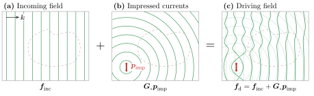
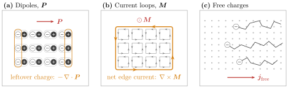
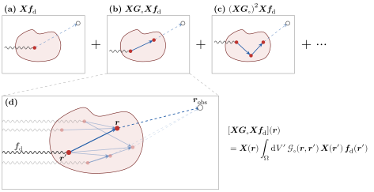

# [1 Maxwell's Equations](@id sec-1)

We start with the macroscopic formulation of Maxwell's equations in free
space and in SI units:

```@raw html
<a id="eq-1.1"></a>
```
```math
\begin{aligned}
    \div{\vb*{d}} &= \rho_e \\
    \div{\vb*{b}} &= \rho_m \\
\curl{\vb*{e}} &= -\ab(\red{\mu_\circ\vb*{j}_m} + \blue{\mu_{\circ}\pdv{\vb*{h}}{t}}) \\
\curl{\vb*{h}} &= \red{\vb*{j}_e} + \blue{\varepsilon_{\circ}\pdv{\vb*{e}}{t}}
\end{aligned}\tag{1.1}
```

where we have introduced an artificial magnetic charge density ``\rho_m`` and
magnetic current density ``\vb*{j}_m`` for symmetry (these quantities are
believed to be zero in free space). We have also done something very particular
(but deliberate): we have split the ``\red{\text{material}}`` and ``\blue{\text{vacuum}}`` response
such that the vacuum response is the only field coupling. Every ``\red{\text{current}}``,
whether impressed by an external source or induced in a material has been taken
into account inside the current densities ``\red{\vb*{j}_e}`` and
``\red{\vb*{j}_m}``. Note that the equations above are truly general (in so far
as Maxwell's equations are a valid description of electromagnetism). We have
*not* restricted ourselves to vacuum only response. Material scattering is
encoded in the current densities. If this doesn't mean anything to you, don't
worry, it just means we have not made any limiting assumptions writing Maxwell's
equations in the form above.

One of the problems with Maxwell's equations written in this formulation is the
lack of symmetry between the electric and magnetic quantities. One solution to
this problem is to move to the Gaussian unit system which puts electric fields
and magnetic fields on equal footing. As a strong believer in the SI system
however, this is a hard sell for me. Instead, we can fake Gaussian units by
scaling the magnetic equations by a factor of ``Z_\circ = \sqrt{\mu_\circ / \varepsilon_\circ}``, the impedance of free
space[^1]. Doing
so and using ``\pdv{}{t} = -i\omega`` (i.e., moving to the frequency
domain[^2]), we can rewrite these
equations in the following matrix form:

```@raw html
<a id="eq-1.2"></a>
```
```math
\begin{align*}
    \underbrace{\begin{bmatrix}
        ik_\circ^{-1} \vb*{j}_e\ab(\vb*{r}) \\
        Z_\circ\varepsilon_\circ ik_\circ^{-1}\vb*{j}_m\ab(\vb*{r})
    \end{bmatrix}}_{\vb*{p}\ab(r)}
    &= \underbrace{-Z_{\circ}^{-1}\begin{bmatrix}
        \bbone & -ik_\circ^{-1}\vb*{\nabla}\times \\
        ik_\circ^{-1}\vb*{\nabla}\times & \bbone
    \end{bmatrix}}_{\bm{M}_{\circ}}
    \underbrace{\begin{bmatrix}
        \vb*{e}\ab(\vb*{r}) \\
        Z_\circ\vb*{h}\ab(\vb*{r})
    \end{bmatrix}}_{\vb*{f}\ab(r)}\tag{1.2}
\end{align*}
```

Note that we have explicitly moved a factor of ``k_\circ = 2\pi / \lambda``
(with ``\lambda`` the wavelength in free space) in front of the curl
operators [^3]
to make the differential operator
spatially scale invariant (i.e., dimensionless). All the extra constants
in [eq. (1.2)](#eq-1.2) are there to ensure that the entries of
``\bm{M}_{\circ}`` are homogeneous, and have units of inverse impedance
(i.e., Siemens in SI units). Keep in mind that, because we are working in the
frequency domain, all the fields and sources pick up a dimension of time. A
summary of the units of the various quantities appearing in these notes can be
found in [table 1](discretization.md#tab-1).

```@raw html
<a id="conv-1.1"></a>
```
!!! convention "Gila convention 1.1: Lengths are measured in wavelengths"
    Because ``k_\circ^{-1}\bm{\nabla}\times`` is scale invariant, Gila works
    internally with wavelength-scaled coordinates ``\vb*{\mathsf{s}} = \ab(\vb*{\mathsf{r}} - \vb*{\mathsf{r}}^\prime)/\lambda``. When we talk about a
    "cell of size ``0.1\times 0.2\times 0.3``" we really mean cell of size
    ``0.1\lambda \times 0.2\lambda \times 0.3\lambda``.

The matrix, ``\bm{M}_{\circ}``, appearing in [eq. (1.2)](#eq-1.2) is known
as the free-space Maxwell operator and is the central object of interest in
electromagnetic scattering. It is with this object (more precisely, its inverse)
that we will efficiently and accurately solve Maxwell's equations.

When we talk about "solving Maxwell's equations" we mean computing some output
quantity given some input quantity. The output quantity is simple: it is the
genuine electromagnetic field (either ``\vb*{f}`` or the associated current
density ``\vb*{p}``, both describe the same physics). The input quantity is a
bit more subtle.

## [1.1 Driving Fields](@id sec-1.1)

The "inputs" to an electromagnetic solver are the quantities that we control.
The typical way of thinking about these "inputs" is one where we may have some
incoming field (e.g., a laser, a plane wave, etc.) and some impressed currents
(e.g., an antenna, a permanently polarized material etc.). Let
``\vb*{f}_\text{inc}`` be these incoming fields and ``\vb*{p}_{\text{imp}}`` be
these impressed currents (see [fig. 1.1](#fig-1.1) for a depiction of this
partitioning). Then we define the *driving* field as ``\vb*{f}_{\text{d}} = \vb*{f}_{\text{inc}} + \bm{M}^{-1}_{\circ}\vb*{p}_{\text{imp}}`` (note that we
have not yet discussed the existence of the inverse of the vacuum Maxwell
operator, but rest assured that this definition of ``\vb*{f}_\text{d}`` is
well-founded). Note that ``\vb*{f}_{\text{inc}}`` must be "Maxwellian" fields,
i.e., they are solutions to the free-space (source-free, divergence-free)
Maxwell equations: ``\bm{M}_{\circ}\vb*{f}_{\text{inc}} = \vb*{0}``. We call
``\vb*{f}_{\text{d}}`` the driving field because it is the input to the system
(it *drives* the system), reminding us of the inhomogeneous term in a
differential equation.

```@raw html
<a id="fig-1.1"></a>
```


Figure 1.1: The inputs to a solve. (a) An incoming field
``\vb*{f}_\text{inc}``, here a plane wave with wavevector ``\vb*{k}``, solves
the source-free Maxwell equations, ``\bm{M}_{\circ} \vb*{f}_\text{inc} = \vb*{0}``. (b) Impressed currents
``\vb*{p}_\text{imp}``, here a small line source, radiate the field
``\bm{G}_\circ\vb*{p}_\text{imp}``. (c) Their sum is the driving field,
``\vb*{f}_\text{d}`` (solid) with the two fields it sums shown faintly
underneath. The scatterer (dashed) is drawn for reference only: the driving
field ignores its response.

## [1.2 Scatterers](@id sec-1.2)

Looking at [eq. (1.2)](#eq-1.2), nowhere do we find any mention of
``\vb*{f}_{\text{d}}``. This is because Maxwell's equations, as written above,
are self-consistent equations. They talk about the *total* fields and
currents (i.e., the genuine fields and currents that "exist"[^4] in nature), and do not care
about how these fields and currents came to be. Denote these total fields and
currents as ``\vb*{f}_\text{t}`` and ``\vb*{p}_\text{t}``, respectively, such
that [eq. (1.2)](#eq-1.2) becomes ``\vb*{p}_{\text{t}} = \bm{M}_{\circ}\vb*{f}_\text{t}``.

Because Maxwell's equations are linear, we can decompose the total fields into
as many components as we want. Since we introduced the driving fields, it is
natural to decompose the total fields into driving and some other quantity:
``\vb*{f}_{\text{t}} = \vb*{f}_{\text{d}} + \vb*{f}_{\text{s}}``
(see [fig. 1.2](#fig-1.2)). We will refer
to this other quantity as the *scattered* fields and we will think of these
fields as the response of the system to the driving fields[^5].

```@raw html
<a id="fig-1.2"></a>
```


Figure 1.2: Splitting the total field. Green: driving field; blue: scattered
field; black: total field. (a) The driving field
of [fig. 1.1](#fig-1.1). (b) The scatterer polarizes,
``\vb*{p}_\text{s} = \bm{X}\vb*{f}_\text{t}`` (red arrows), and
radiates the scattered field ``\vb*{f}_\text{s} = \bm{G}_\circ\vb*{p}_\text{s}``. (c) The total field ``\vb*{f}_\text{t} = \vb*{f}_\text{d} + \vb*{f}_\text{s}`` (solid black), with the driving and
scattered fields shown faintly underneath.

## [1.3 Material Response](@id sec-1.3)

The one piece missing is that of the material response. When we wrote Maxwell's
equations in [eq. (1.1)](#eq-1.1), we said that all the material response is
encoded in the current densities ``\vb*{j}_e`` and ``\vb*{j}_m``. Below we
elaborate the physics of this.

Matter is made of charges zipping around on the scale of atoms. We don't care
about any of that detail: we blur our eyes over some length scale ``\ell`` and
only keep track of what the charges do on average. For this to work, ``\ell``
has to be much bigger than the atomic spacing ``a``, so that each blurred region
holds lots of atoms, and much smaller than ``1/\abs{\vb*{k}}``, the smallest
scale on which our fields and geometry change, so that we don't blur away
anything we care about. Take silicon: its lattice constant is ``a \approx 0.5\ \text{nm}``, and if we want to resolve features of about
10 nm (which is roughly what the smallest feature we can etch
into silicon nowadays), blurring over ``\ell \sim 2\ \text{nm}`` works
fine. In full 3D, this averaging gives us a few hundred atoms "blurred region"
(see [fig. 1.3](#fig-1.3)) which is more than enough to get a good
description of the material response.

```@raw html
<a id="fig-1.3"></a>
```


Figure 1.3: Blurring matter to get an effective material response. (a) At the atomic scale
``a``, a field ``\vb*{e}`` pushes each electron cloud (gray) off its nucleus,
away from where it sits without a field (dashed), making a small dipole
``q\vb*{x}``. (b) A blurred region of size ``\ell`` holds
thousands of atoms (the small box is panel (a)). Averaging over it leaves a
single dipole density ``\vb*{P}``. (c) Across the scatterer, ``\vb*{P}`` varies
smoothly on the scale ``1/\abs{\vb*{k}}`` (the small box is panel (b)). The
three scales are ordered ``a \ll \ell \ll 1/\abs{\vb*{k}}``. (d) The microscopic
charge density along one line (top) and its average over a window of width
``\ell`` (bottom). After the averaging, we can really only see
``-\div{\vb*{P}}``.

Blurring the charges gives us a series of increasingly fine
structure—specifically, a multipole expansion:

```math
\begin{align*}
    \braket<\rho> &= \rho_{\text{free}} - \vb*{\nabla}\cdot {\vb*{P}}  + \frac{1}{6} \vb*{\nabla}\cdot {\vb*{\nabla}\cdot {\bm{Q}}} - \dots \\
    \braket<\vb*{j}> &= \vb*{j}_\text{free} + \pdv{\vb*{P}}{t} + \vb*{\nabla}\times {\vb*{M}} - \frac{1}{6} \pdv{}{t}\vb*{\nabla}\cdot {\bm{Q}} + \dots
\end{align*}
```

The free charges contribute a trivial piece of the puzzle. Everything else comes
from bound charges, which can only be nudged around their atoms:

- ``\vb*{P}`` is the (electric) dipole density. A field pulls electrons
  one way and nuclei the other, creating tiny dipoles in the material. Deep inside
  the material, neighbouring dipoles cancel each other out, but wherever
  ``\vb*{P}`` is uneven, there is some charge left over, hence the term
  ``-\vb*{\nabla}\cdot{\vb*{P}}``. If the dipoles wiggle, charge is physically moving back and
  forth, which is a current, yielding the ``\pdv{}{t}\vb*{P}`` term.
- ``\vb*{M}`` is the magnetic dipole density, or magnetization. It is
  the amount of little current loops per unit volume (due to electrons orbiting
  and spinning). Neighbouring loops cancel in the bulk, so only the edges are left,
  yielding the ``\vb*{\nabla}\times {\vb*{M}}`` term.
- ``\bm{Q}``, the quadrupole density, is the next level of detail. It
  describes how the charge is arranged *within* each dipole. It is smaller
  than the dipole terms by roughly ``\abs{\vb*{k}}a``, which is about ``0.01`` for
  our silicon example, so we neglect it and every term after.

Strictly speaking, ``\vb*{M}`` is just as small as ``\bm{Q}``. We keep it anyway
because it adds symmetry to the electric and magnetic sides. In practice, it's
essentially zero for ordinary materials at optical frequencies.

```@raw html
<a id="fig-1.4"></a>
```


Figure 1.4: Result after averaging. (a) Neighbouring dipoles cancel in
the bulk, leaving only the uncompensated charge at the edges,
``-\div{\vb*{P}}``. (b) Neighbouring current loops cancel along
shared walls, leaving only the circulation around the edge,
``\curl{\vb*{M}}``. (c) Free electrons move through the lattice of ions, carrying a
current ``\vb*{j}_\text{free}`` (opposite to their motion).

Now, we'll sort these terms into the currents ``\vb*{j}_e`` and ``\vb*{j}_m`` we
wrote in [eq. (1.1)](#eq-1.1). At a single frequency, a free current sloshing
back and forth looks exactly like a wiggling dipole density, since
``\vb*{j}_\text{free} = \pdv{}{t} \vb*{P}_\text{free}`` for some
``\vb*{P}_\text{free}``. So we fold any free current the material carries in
response to the field into ``\vb*{P}``. The magnetization loops are real
electric currents, and we could just leave ``\curl{\vb*{M}}`` inside
``\vb*{j}_e``. Instead, we make a bookkeeping choice: we call ``\vb*{h} = \vb*{b}/\mu_\circ - \vb*{M}`` our magnetic field, which moves this term out of
Ampère's law and into Faraday's law, where it shows up as a magnetic current.
Either way the physics is the same, but this choice treats the two sides
symmetrically:

```math
\begin{align*}
    \vb*{j}_e &= \pdv{\vb*{P}}{t}, & \vb*{j}_m &= \pdv{\vb*{M}}{t}.
\end{align*}
```

Going to the frequency domain (``\pdv{}{t} \mapsto -i\omega``) and plugging into
our definition of ``\vb*{p}``, using ``\omega/k_\circ = c`` and
``Z_\circ\varepsilon_\circ c = 1``, we find:

```math
    \vb*{p} = \begin{bmatrix} c\vb*{P} \\ \vb*{M} \end{bmatrix}.
```

So ``\vb*{p}`` is just the dipole density (electric and magnetic), with a factor
of ``c`` to make the units match.

With this, we can figure out exactly what ``\vb*{p}_\text{s}``, the scattered
polarization current density, is. The total current ``\vb*{p}_\text{t}`` in our
problem comes from two places: the currents we put in by hand,
``\vb*{p}_\text{imp}``, and whatever the material does in response. The second
piece is ``\vb*{p}_\text{s} = \vb*{p}_\text{t} - \vb*{p}_\text{imp}``. Since the
material's response is only dipoles and loops, ``\vb*{p}_\text{s} = \begin{bmatrix} c \vb*{P} \\ \vb*{M} \end{bmatrix}``.

What's left is to say *how much* ``\vb*{P}`` a field induces. Picture a
bound electron as a ball on a spring with some friction. The field pushes on
this ball giving:

```math
    m\ab(\ddot{\vb*{x}} + \gamma\dot{\vb*{x}} + \omega_\circ^2\vb*{x}) = q\vb*{e}
    \quad\Longrightarrow\quad
    \vb*{x} = \frac{q/m}{\omega_r^2 - \omega^2 - i\gamma\omega}\,\vb*{e}.
```

Each electron is a little dipole ``q\vb*{x}``. This is where we blur our eyes.
Each blurred region holds lots of these dipoles (``N`` per unit volume) so that
the polarization is ``\vb*{P} = Nq\vb*{x}``:

```math
    \vb*{P} = \varepsilon_\circ\chi_e\vb*{e}, \qquad
    \chi_e = \frac{\omega_p^2}{\omega_r^2 - \omega^2 - i\gamma\omega}, \qquad
    \omega_p^2 = \frac{Nq^2}{\varepsilon_\circ m}.
```

The magnetic side works the same way, ``\vb*{M} = \bm{\chi}_m\vb*{h}``.

Putting it together, we have

```@raw html
<a id="eq-1.3"></a>
```
```math
    \vb*{p}_\text{s} = \begin{bmatrix}
c\varepsilon_\circ\bm{\chi}_e\vb*{e}_\text{t} \\ \bm{\chi}_m\vb*{h}_\text{t}
\end{bmatrix} = \underbrace{Z_\circ^{-1}\begin{bmatrix} \bm{\chi}_e & \bm{0} \\
\bm{0} & \bm{\chi}_m \end{bmatrix}}_{\bm{X}} \begin{bmatrix} \vb*{e}_\text{t} \\
Z_\circ\vb*{h}_\text{t} \end{bmatrix} = \bm{X}\vb*{f}_\text{t}.\tag{1.3}
```

```@raw html
<a id="conv-1.2"></a>
```
!!! convention "Gila convention 1.2: Any material response is allowed in Gila"
    In Gila, you can define your own material response. The only requirement is that
    it is linear so that it can be written as a matrix ``\bm{\mathsf{X}}``. By
    default [`SusOpr`](@ref) assumes a local response (which means that
    ``\bm{\mathsf{X}}`` is (block) diagonal), though no assumption is made about
    anisotropy.

## [1.4 "Free" Space](@id sec-1.4)

So far, we have written Maxwell's equations in reference to a background medium
with permittivity ``\varepsilon_\circ`` and permeability ``\mu_\circ``. Nowhere
did we need the actual values of these quantities, and in fact, we could have
written Maxwell's equations in reference to any linear, isotropic, homogeneous
medium. For the sake of clarity, we will refer to this arbitrary background
medium as "free space" and denote its material properties with the symbol
``\circ``, but truly any linear, isotropic, homogeneous medium will do. The only
thing that changes is the susceptibility tensor (sometimes referred to as the
*contrast* tensor for this exact reason) defined as the relative difference
between the material properties of the scatterer and the background medium. That
is, when the material's properties coincide with that of the background, the
susceptibility tensor is zero.

## [1.5 The Scattering Relation](@id sec-1.5)

Now that we have defined all the different
fields and currents, let's see how we can relate them to one another. Consider the
(computational) domain ``\Omega \subset \mathbb{R}^{3}`` where we will study
Maxwell's equations. We will impose open radiating boundary conditions on
``\Omega``, meaning that any radiation that leaves the domain will not come back
in (and is assumed to be absorbed at infinity).

```@raw html
<a id="conv-1.3"></a>
```
!!! convention "Gila convention 1.3: Open and Periodic Boundary Conditions"
    By default, Gila assumes open radiation boundary conditions along every axis.
    For now, there are two types of boundary conditions implemented in Gila: open
    (radiating) and periodic. One can apply either of these boundary conditions
    along any axis, i.e., you can have periodic boundary conditions along ``x`` and
    open boundary conditions along ``y`` and ``z``. Note that "periodic" here
    means Bloch-phase quasi-periodic, i.e., ``\vb*{\mathsf{p}}(\vb*{\mathsf{r}} + \vb*{\mathsf{L}}) = e^{-i\vb*{\mathsf{k}}\cdot\vb*{\mathsf{L}}}\vb*{\mathsf{p}}(\vb*{\mathsf{r}})``
    where ``\vb*{\mathsf{L}}`` is the periodicity vector and ``\vb*{\mathsf{k}}`` is
    the Bloch wavevector. The period must be a whole number of cells, and periodic
    boundary conditions are only available when the source and target volumes are
    the same.

We already have ``\bm{M}_{\circ}`` which, as defined
in [eq. (1.2)](#eq-1.2), takes a field distribution ``\vb*{f}`` in
``\Omega`` to a current distribution ``\vb*{p}`` in ``\Omega``. Let
``\bm{G}_{\circ}`` be the linear operator that maps a current distribution
``\vb*{p}`` to a field distribution ``\vb*{f}`` such that it obeys the boundary
conditions and inverts ``\bm{M}_{\circ}`` on radiated fields. That is, for all
``\vb*{p}``, we have ``\bm{M}_{\circ} \bm{G}_{\circ} \vb*{p} = \vb*{p}``.

Earlier, we wrote that the driving field ``\vb*{f}_\text{d}`` was the sum of the
incoming field ``\vb*{f}_\text{inc}`` (think of a plane wave) and the field
associated with the impressed currents ``\bm{M}_{\circ}^{-1}\vb*{p}_\text{imp}``
(think of a permanently polarized material). Strictly speaking, this inverse is
not well-defined, but replacing it with ``\bm{G}_{\circ}`` is legitimate:
``\vb*{f}_\text{d} = \vb*{f}_\text{inc} + \bm{G}_{\circ} \vb*{p}_\text{imp}``.
The reason ``\bm{M}_{\circ}^{-1}`` is ill-defined is that ``\bm{M}_{\circ}`` has
a nontrivial null space (any incident field, like a plane wave, is such that
``\vb*{M}_{\circ}\vb*{f}_\text{inc} = \vb*{0}``) and thus cannot be inverted
uniquely. The operator ``\bm{G}_{\circ}`` is well-defined because it
picks[^6] the unique
solution to the Maxwell equations that radiates away from the domain.

Decomposing the total field into driving and scattered fields, we have
``\vb*{f}_\text{t} = \vb*{f}_\text{d} + \vb*{f}_\text{s}``. With
``\vb*{p}_\text{s} = \bm{X}\vb*{f}_\text{t}`` and
``\bm{G}_{\circ}\vb*{p}_\text{s} = \vb*{f}_\text{s}``, we have:

```math
\begin{align*}
\vb*{f}_\text{t} &= \vb*{f}_\text{d} + \bm{G}_{\circ}\bm{X}\vb*{f}_\text{t} \\
\implies \ab(\bbone - \bm{G}_{\circ}\bm{X})\vb*{f}_\text{t} &= \vb*{f}_\text{d}
\end{align*}
```

Multiplying both sides on the left by ``\bm{X}`` and recognizing that ``\bm{X} - \bm{X}\bm{G}_{\circ}\bm{X} = \bm{X}\ab(\bbone - \bm{G}_{\circ}\bm{X}) = \ab(\bm{\bbone} - \bm{X}\bm{G}_{\circ})\bm{X}``, we arrive at:

```math
\begin{align*}
\ab(\bbone - \bm{X}\bm{G}_{\circ}) \bm{X}\vb*{f}_\text{t} &= \bm{X}\vb*{f}_\text{d}
\end{align*}
```

Recall that ``\vb*{p}_\text{s} = \bm{X}\vb*{f}_\text{t}`` and define
``\vb*{p}_\text{d} = \bm{X}\vb*{f}_\text{d}`` as the driving current density
(i.e., the current density that arises from the driving field, ignoring any
scattering response) to get the scattering relation:

```math
\begin{align*}
\ab(\bbone - \bm{X}\bm{G}_{\circ}) \vb*{p}_\text{s} &= \vb*{p}_\text{d}
\end{align*}
```

We usually define ``\bm{W} = \ab(\bbone - \bm{X}\bm{G}_{\circ})^{-1}`` (where
the inverse is understood to be defined on the range of ``\bm{X}`` and the
operator is zero elsewhere) to write the scattering relation in the more compact form:

```@raw html
<a id="eq-1.4"></a>
```
```math
\begin{align*}
\vb*{p}_\text{s} &= \bm{W}\vb*{p}_\text{d}
\tag{1.4}
\end{align*}
```

Solving Maxwell's equations amounts to solving [eq. (1.4)](#eq-1.4) for
``\vb*{p}_\text{s}`` given some driving current density ``\vb*{p}_\text{d}``.
Once we have ``\vb*{p}_\text{s}``, we can find the total fields
``\vb*{f}_\text{t} = \vb*{f}_\text{d} + \bm{G}_{\circ}\vb*{p}_\text{s}``.

The primary purpose of Gila is to efficiently and accurately compute that
action of ``\bm{G}_{\circ}`` on some current distribution ``\vb*{p}``, that is,
Gila computes ``\vb*{f} = \bm{G}_{\circ} \vb*{p}``. With this, we can do many
things. One of them is solving Maxwell's equations through [eq. (1.4)](#eq-1.4),
but that is far from the only thing we can do. Knowing how ``\bm{G}_{\circ}`` acts (as
well as ``\bm{X}``), we can compute many interesting physical quantities such as
the local density of states, the Purcell factor, Casimir forces, etc. These are
not discussed in these notes, however. The rest of the document is dedicated to
understanding how Gila computes the action of ``\bm{G}_{\circ}``.

By knowing only how ``\bm{G}_{\circ}`` *acts* on a vector, i.e., without
having to actually *form* the matrix ``\bm{G}_{\circ}``, we can
solve [eq. (1.4)](#eq-1.4) for ``\vb*{p}_\text{s}`` given some driving current
density. The technique to do so is called an iterative solver, and is discussed
in [section 6.2](@ref sec-6.2).

## [1.6 Interpreting ``\bm{W}`` as Multiple Scattering](@id sec-1.6)

We could write ``\bm{W} = \ab(\bbone - \bm{X}\bm{G}_{\circ})^{-1}``, but we have
to be careful about the domain of validity. This is technically only
well-defined over the range of ``\bm{X}``, so from now on, when we write
``\bm{W} = \ab(\bbone - \bm{X}\bm{G}_{\circ})^{-1}`` (or the inverse of any such
scattering operator), we will assume the domain is restricted to the range of
``\bm{X}``.

Working with this representation, we can write out the series expansion of ``\bm{W}`` as:

```math
\begin{align*}
    \bm{W} &= \ab(\bbone - \bm{X}\bm{G}_{\circ})^{-1} \\
        &= \sum_{n=0}^{\infty} \ab(\bm{X}\bm{G}_{\circ})^n = \bm{\bbone} + \bm{X}\bm{G}_{\circ} + \ab(\bm{X}\bm{G}_{\circ})^2 + \dots
\end{align*}
```

This is just the extension of the geometric series to operators (and is called the Neumann series). 
Notice that if we multiply both sides by ``\bm{X}`` on the right, we get
something with a nice symmetry:

```math
\begin{align*}
    \text{Let }\bm{T} &= \bm{W}\bm{X} \\
    &= \bm{X} + \bm{X}\bm{G}_{\circ}\bm{X} + \bm{X}\bm{G}_{\circ}\bm{X}\bm{G}_{\circ}\bm{X} + \bm{X}\bm{G}_{\circ}\bm{X}\bm{G}_{\circ}\bm{X}\bm{G}_{\circ}\bm{X} + \dots \\
    &= \bm{X} + \bm{X}\bm{G}_{\circ}\ab(\bm{X} + \bm{X}\bm{G}_{\circ}\bm{X} + \bm{X}\bm{G}_{\circ}\bm{X}\bm{G}_{\circ}\bm{X} + \dots) \\
    &= \bm{X} + \bm{X}\bm{G}_{\circ}\bm{T}
\end{align*}
```

The ``\bm{T}`` operator takes a driving ``\vb*{f}_\text{d}`` and returns the
scattered current density ``\vb*{p}_\text{s}`` (i.e., ``\vb*{p}_\text{s} = \bm{T}\vb*{f}_\text{d}``).

This series expansion has a nice physical interpretation. Each term in the
series can be thought of as a scattering event. The first term (the zeroth order
term) ``\bm{X}\vb*{f}_\text{d}`` is the current density that we get if we ignore
any propagation. The way to think about the second term (the first order term)
``\bm{X}\bm{G}_{\circ}\bm{X}\vb*{f}_\text{d}`` is looking right to left: we let
the material polarize in response to the driving field, then we propagate that
polarization, then that new field in turn polarizes the material again. Each
term is then successive scattering events, where the material polarizes in
response to the field, then that polarization propagates, then the new field
polarizes the material again, and so on. This process is illustrated in
[fig. 1.5](#fig-1.5).

```@raw html
<a id="fig-1.5"></a>
```


Figure 1.5: The Born series as paths through the scatterer. Each of (a)–(c) shows
one representative path from one term of ``\vb*{p}_\text{s} = \bm{T}\vb*{f}_\text{d}``: the driving field (wavy line) polarizes the
material at a scattering event (red dot, ``\bm{X}``), each solid arrow
propagates that polarization to another point of the scatterer
(``\bm{G}_\circ``), and the dashed line measures the final polarization out at
an observation point ``\vb*{r}_\text{obs}`` through the extra
``\bm{G}_\circ`` in ``\vb*{f}_\text{s} = \bm{G}_\circ\vb*{p}_\text{s}``.
(a) Zeroth order, (b) first order, (c) second order. (d) Zoom on the
first-order term: it is the sum of many paths for every ordered pair of points
``(\vb*{r}', \vb*{r})`` in the scatterer, all sharing the same incoming
field and observation point. The bold path is the one drawn in (b).

With this picture in mind, we can think of resonances as the result of a
feedback loop. A current pattern that is able to reproduce itself (or something
very close to itself) after a scattering event will keep going through the loop
over and over again. Mathematically, these resonances occur when the operator
``\bbone - \bm{X}\bm{G}_{\circ}`` is nearly singular, i.e., when
``\bm{X}\bm{G}_{\circ}`` has an eigenvalue close to unity. These resonances are
very hard to solve for numerically, and are one main reason why we need advanced
tricks, like those detailed in [section 6.2](@ref sec-6.2), to solve Maxwell's
equations efficiently.

[^1]: See [section 1.4](@ref sec-1.4) for what is meant by free space

[^2]: See [appendix A](@ref sec-A) for the convention of the Fourier transforms we use in these notes.

[^3]: We have also moved a factor of ``-i`` in front of the curls, yielding ``-\frac{i}{k_{\circ}}\curl``.

[^4]: In so far as one believes that fields and currents exist.

[^5]: If the phrase "response of the system to the driving field" means nothing to you, you are not alone. It is okay to not have intuition about that ``\vb*{f}_{\text{s}}`` is, as it is truly a manufactured (maybe even arbitrary) decomposition of the field that exists in nature. The simplest way to understand ``\vb*{f}_\text{s}`` is that it is the difference between the true field that exists (``\vb*{f}_{\text{t}}``) and whatever input you gave to your electromagnetic solver (``\vb*{f}_{\text{d}}``).

[^6]: This is how we *define* ``\bm{G}_{\circ}``
