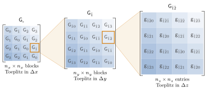
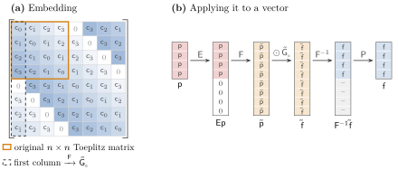
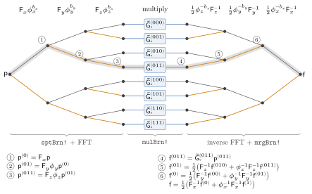

# [5 Toeplitz Structure of the Green Function](@id sec-5)

Theoretically, with the knowledge of how to build the discretized Green tensor ``\bm{\mathsf{G}}_{\circ}``, we can compute our solution to Maxwell's equations, and all is good. The problem is that of size. If we have ``N = n_x n_y n_z`` voxels (with ``n_x`` voxels along ``x``, ``n_y`` along ``y``, and ``n_z`` along ``z``), then ``\bm{\mathsf{G}}_{\circ}`` is a ``3N \times 3N`` matrix, requiring ``\order{N^3} = \order{n_i^6}`` memory to store. This is, simply, *terribly* infeasible to store on a computer. For a typical discretization of 32 cells per wavelength, a moderate ``64\lambda^3`` domain would require 288 TiB of storage! If it costs that much to just *store* the tensor, then doing anything with it (such as solving the linear system) is totally out of the question. Clearly, we need to do something to not have to store the entire tensor. Luckily, we can exploit one of the symmetries of vacuum: translation invariance.

No matter where you look in free space, the physics is the same. This is called translation invariance. If we also use boundary conditions that share this property (such as periodic boundary conditions, or radiating boundary conditions), then the whole tensor ``\bm{\mathsf{G}}_{\circ}`` will enjoy this symmetry. Specifically, looking at [eq. (4.5)](matrix_elements.md#eq-4.5), one may notice that[^12] ``\bm{G}_{\circ}``, which in general may depend on both ``\vb*{r}`` and ``\vb*{r}^\prime``, actually only depends on the difference, i.e., ``\bm{G}_{\circ}\ab(\vb*{r}, \vb*{r}^\prime) = \bm{G}_{\circ}\ab(\vb*{r} - \vb*{r}^\prime)``. This means that we do not need to keep track of how every position ``\vb*{r}`` interacts with every other position ``\vb*{r}^\prime``, but rather we only need to keep track of how every position interacts with every *relative* position. This is a massive saving in storage and is also the key to speedy applications of the Green function operator on a vector.

Due to this symmetry, the Green function tensor is a block Toeplitz matrix with Toeplitz blocks (BTTB). A Toeplitz matrix is a matrix that is constant along all its diagonals. The BTTB structure of ``\bm{\mathsf{G}}_{\circ}`` is illustrated in [fig. 5.1](#fig-5.1). BTTB matrices can be embedded into a larger space to become block circulant matrices with circulant blocks (BCCB). A circulant matrix is a matrix that is constant along all its diagonals and wraps around at the edges (i.e., the second row is the first row shifted to the right by one, and the last element of the first row is the first element of the second row, etc.). One nice property of circulant matrices is that they are completely determined by their first row (or column). This means that we only need to store ``N`` elements instead of ``N^2`` (see [fig. 5.2](#fig-5.2)). Additionally, BCCB matrices turn out to be diagonalized by the discrete Fourier transform (DFT)[^13]. This is advantageous because of the fast Fourier transform (FFT) algorithm, which allows us to apply the DFT in ``\order{N\log N}`` time.

```@raw html
<a id="fig-5.1"></a>
```



Figure 5.1: Block Toeplitz structure of ``\bm{\mathsf{G}}_{\circ}``, drawn for ``n_x = n_y = n_z = 4``. Subscripts are offsets between target and source indices, written ``\bar{1} = -1``. Left: grouping voxels by their ``x`` index, ``\bm{\mathsf{G}}_{\circ}`` is an ``n_x \times n_x`` block matrix whose block ``\mathsf{G}_{\Delta x}`` depends only on the ``x`` separation ``\Delta x``. Middle: one of those blocks, ``\mathsf{G}_{\bar{1}}``, magnified. It is itself block Toeplitz, with blocks ``\mathsf{G}_{\bar{1}\Delta y}``. Right: one of its blocks, ``\mathsf{G}_{\bar{1}\bar{2}}``, magnified. It is an ``n_z \times n_z`` Toeplitz matrix with entries ``\mathsf{g}_{\bar{1}\bar{2}\Delta z}``. Each entry is itself a ``3\times3`` polarization block.

```@raw html
<a id="fig-5.2"></a>
```



Figure 5.2: Circulant embedding along one axis, drawn for ``n = 4``. (a) The ``n\times n`` Toeplitz matrix (orange) is the top-left corner of a ``2n\times2n`` circulant: every diagonal wraps around, so the entries outside the corner are copies of the same ``\mathsf{c}_d`` (same shade). There is always an extra entry we can freely choose that has been set to 0. The entire circulant is fixed by its first column (dashed), whose DFT is the symbol ``\tilde{\bm{\mathsf{G}}}_\circ``. (b) Applying the circulant matrix to a vector: pad ``\vb*{\mathsf{p}}`` with zeros, transform (FFT), multiply entrywise by the symbol, transform back (iFFT), and keep the first ``n`` entries. The discarded half (dashes) comes from the circulant's extra rows.

Specifically, given a discretized current vector ``\vb*{\mathsf{p}}``, we may compute its image under the vacuum Green function ``\vb*{\mathsf{f}} = \bm{\mathsf{G}}_{\circ} \vb*{\mathsf{p}}`` as:

```math
\begin{align*}
\vb*{\mathsf{f}} &= \ab(\prod_{\gamma \in \left\{x, y, z\right\}}
\bm{\mathsf{P}}_\gamma \bm{\mathsf{F}}^{-1}_\alpha) \bm{\tilde{\mathsf{G}}}_{\circ}
\ab(\prod_{\gamma \in \left\{x, y, z\right\}} \bm{\mathsf{F}}_\gamma
\bm{\mathsf{E}}_\gamma) \vb*{\mathsf{p}}
\end{align*}
```

where ``\bm{\mathsf{F}}_\gamma`` is the DFT along dimension ``\gamma`` (with inverse DFT ``\bm{\mathsf{F}}_\gamma^{-1}`` and ``\bm{\mathsf{E}}_\gamma`` the embedding operator along dimension ``\gamma`` (with adjoint ``\bm{\mathsf{P}}_\gamma = \bm{\mathsf{E}}_\gamma^\dagger``—the projection operator along dimension ``\gamma``). The embedding operator ``\bm{\mathsf{E}}_\gamma`` takes a vector of length ``n_\gamma`` and embeds it into a vector of length ``2n_\gamma`` by padding with zeros. The projection operator ``\bm{\mathsf{P}}_\gamma`` takes a vector of length ``2n_\gamma`` and projects it down to a vector of length ``n_\gamma`` by taking the first ``n_\gamma`` elements. The DFT and inverse DFT matrices can be applied in ``\order{N\log N}`` time using the FFT algorithm, and the embedding and projection operators can be applied in ``\order{N}`` time by just doing some indexing. The way this is implemented in Gila is illustrated in [fig. 5.3](#fig-5.3).

```@raw html
<a id="fig-5.3"></a>
```



Figure 5.3: How Gila applies ``\bm{\mathsf{G}}_{\circ}`` to ``\vb*{\mathsf{p}}``. Along each axis ``\gamma \in \left\{x, y, z\right\}``, every branch splits in two: the plain branch (``b_\gamma = 0``, black) takes a length-``n_\gamma`` FFT ``\bm{\mathsf{F}}_\gamma``, and the twiddled branch (``b_\gamma = 1``, orange) is first multiplied by the half-phase diagonal ``\phi_\gamma``, with entries ``e^{-i\pi j/n_\gamma}`` for ``j = 0, \dots, n_\gamma - 1``. After ``x``, ``y`` and ``z`` there are eight branches, each the size of ``\vb*{\mathsf{p}}``, and each is multiplied by its own diagonal symbol ``\tilde{\bm{\mathsf{G}}}_\circ^{(b_xb_yb_z)}``. The inverse FFTs then undo the twiddles and sum each pair of branches back together, in reverse order, to give ``\vb*{\mathsf{f}} = \bm{\mathsf{G}}_{\circ}\vb*{\mathsf{p}}``. The shaded path, ``(b_xb_yb_z) = (011)``, is described step by step in the key, with ``\mathsf{p}^{(b_x\cdots)}`` the branch selected by those bits so far and ``\mathsf{f}^{(b_x\cdots)}`` the partially merged result of the branches sharing those bits.

```@raw html
<a id="conv-5.1"></a>
```

!!! convention "Gila convention 5.1: Even Number of Cells in Each Dimension"
    To simplify the circulant embedding, Gila supports an even number of cells along each dimension only.

The operator ``\bm{\tilde{\mathsf{G}}}_{\circ}`` is the Fourier transform of the embedded Green function operator. With ``\vb*{\mathsf{k}} = \begin{bmatrix} k_x & k_y & k_z \end{bmatrix}`` over the ``2n_x \times 2n_y \times 2n_z`` discretized Fourier space,[^14] the symbol is diagonal and has matrix elements

```math
\begin{align*}
\ab[\tilde{\bm{\mathsf{G}}}_{\circ}]_{\alpha\beta}\ab(\vb*{\mathsf{k}}) &=
\sum_{\vb*{\mathsf{r}}} \mathsf{c}_{\alpha\beta}\ab(\vb*{\mathsf{r}}) \exp(-i \pi \sum_{\gamma} \mathsf{r}_\gamma \mathsf{k}_\gamma / n_\gamma)
\end{align*}
```

with the sum running positions ``\vb*{\mathsf{r}} = \vb*{\mathsf{r}}_m - \vb*{\mathsf{r}}_n`` that have been shifted to be in the positive octant of the embedding volume and ``\mathsf{c}_{\alpha\beta}\ab(\vb*{\mathsf{r}}) = \ab[\bm{\mathsf{G}}_{\circ}]_{m\alpha, n\beta}``.

```@raw html
<a id="conv-5.2"></a>
```

!!! convention "Gila convention 5.2: Compressed Storage of the Green Function Kernel"
    Due to a physical property of reciprocal media (called reciprocity), the vacuum Green function kernel ``\bm{\mathcal{G}}_{\circ}`` is complex symmetric, i.e., ``\bm{\mathcal{G}}_{\circ}\ab(\vb*{r}^\prime - \vb*{r}) = \bm{\mathcal{G}}_{\circ}^\top \ab(\vb*{r} - \vb*{r}^\prime)``. This means that we only need to store the upper (or lower) triangular part of the ``3\times 3`` polarization block. The storage convention in Gila is that `GlaOprVac.mem.egoFur` stores the Fourier transform of the kernel matrix elements as the vector ``\begin{bmatrix} \ab[\tilde{\bm{\mathsf{G}}}_{\circ}]_{xx} & \ab[\tilde{\bm{\mathsf{G}}}_{\circ}]_{yy} & \ab[\tilde{\bm{\mathsf{G}}}_{\circ}]_{zz} & \ab[\tilde{\bm{\mathsf{G}}}_{\circ}]_{xy} & \ab[\tilde{\bm{\mathsf{G}}}_{\circ}]_{xz} & \ab[\tilde{\bm{\mathsf{G}}}_{\circ}]_{yz} \end{bmatrix}``, in that order, where

    ```math
    \tilde{\bm{\mathsf{G}}}_{\circ} = \begin{bmatrix}
    \ab[\tilde{\bm{\mathsf{G}}}_{\circ}]_{xx} &
    \ab[\tilde{\bm{\mathsf{G}}}_{\circ}]_{xy} &
    \ab[\tilde{\bm{\mathsf{G}}}_{\circ}]_{xz} \\
    \ab[\tilde{\bm{\mathsf{G}}}_{\circ}]_{yx} &
    \ab[\tilde{\bm{\mathsf{G}}}_{\circ}]_{yy} &
    \ab[\tilde{\bm{\mathsf{G}}}_{\circ}]_{yz} \\
    \ab[\tilde{\bm{\mathsf{G}}}_{\circ}]_{zx} &
    \ab[\tilde{\bm{\mathsf{G}}}_{\circ}]_{zy} &
    \ab[\tilde{\bm{\mathsf{G}}}_{\circ}]_{zz}
    \end{bmatrix}.
    ```

[^12]: Since our discretization into a uniform cuboid mesh is also translationally invariant, the discretized tensor ``\bm{\mathsf{G}}_{\circ}`` shares the same symmetry as ``\bm{G}_{\circ}``.
[^13]: More precisely, if ``\bm{\mathsf{F}}_\gamma`` denotes the DFT along dimension ``\gamma`` then a three level circulant matrix is diagonalized by the Krohnecker product ``\bm{\mathsf{F}}_x\otimes\bm{\mathsf{F}}_y\otimes\bm{\mathsf{F}}_z``
[^14]: The factor of 2 in each dimension comes from the embedding process.
